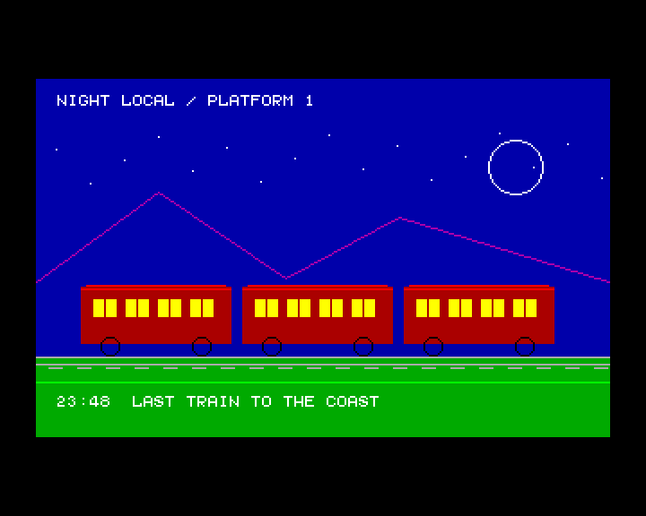
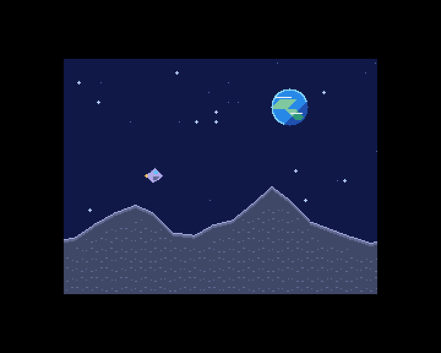

# zxevo-sdk

[](README.md)
[](README.ru.md)

| [BaseConf · Night Train](lib/baseconf/README.en.md)                                  | [TSConf · Moon Run](lib/tsconf/README.en.md)                                                          |
| ------------------------------------------------------------------------------------ | ----------------------------------------------------------------------------------------------------- |
|  |  |

A C and Z80 assembly SDK for ZX Evolution applications on BaseConf and TSConf. It includes shared
APIs, BASIC 48 examples, and tests that run in ZEsarUX.

## Hardware and APIs

- **Both configurations** share console and graphics APIs, RAM page allocation and a banked heap,
  CPU clock and interrupt control, PT3 playback and Covox output, Kempston mouse, RTC and PS/2,
  UART, and low-level access to SD, Nemo IDE and Beta Disk.
  [Shared modules](lib/common/README.en.md)
- **BaseConf** supports the ZX, ZX Multicolor, Pentagon 16-color, ATM 320 and ATM 640 graphics
  modes, plus ATM and Evo 80×25 hardware text. Its hardware APIs cover the two memory maps,
  RAM and Flash mapping, palettes, NewIRQ, ERS ROM services and the floppy emulator overlay.
  [BaseConf modules](lib/baseconf/README.en.md)
- **TSConf** supports ZX graphics, 16- and 256-color packed graphics and hardware text. Its APIs
  cover hardware scrolling, tile layers and sprites, DMA, paging and cache control, raster
  interrupts, Kempston joystick, FDDVirt and TS-BIOS FAT services. Extension modules cover
  Copper, FDR, FT812, ZiFi and ZiFi32 on builds that provide the corresponding hardware.
  [TSConf modules](lib/tsconf/README.en.md)

## Quick start

Build both libraries with GNU Make and z88dk (SDCC and classic library).

```sh
export PATH="/path/to/z88dk/bin:$PATH"
export ZCCCFG="/path/to/z88dk/lib/config"
make
```

Run `make examples` to build the BASIC 48 TAPs or `make test` to run the emulator suites. See the
[example launch instructions](lib/common/README.en.md#basic-48-startup-profile) and
[test setup](lib/test_support/README.en.md#running-the-suites).

## Use the SDK in an application

Set `ZXEVO_SDK_PATH` to the absolute path to the SDK checkout. In the application Makefile, include
`$(ZXEVO_SDK_PATH)/lib/baseconf/baseconf.mk` or `$(ZXEVO_SDK_PATH)/lib/tsconf/tsconf.mk`.
The fragment supplies the target configuration, include paths, library path, and ABI flags.

Before building an application, decide who prepares its environment, how it receives control
and what happens when it exits. When BASIC 48 calls a program, for example, startup saves the
BASIC stack pointer and registers needed for the return. On exit it restores them and hands
control back to the interpreter. This startup code (`crt0` in z88dk) also prepares the C runtime
and calls `main()`. The SDK's CRTs call `zx_init()` before `main()` and `zx_shutdown()` on
exit by default.

- **Default Z80 CRT.** Both `BASECONF_APP_FLAGS` and `TSCONF_APP_FLAGS` select the shared
  `z80_crt0.asm`. Use it for a standalone program entered by your loader or firmware. Set the
  load address, stack and interrupts to match that environment. By default, the program stops
  when `main()` returns.
- **BASIC 48.** Use `BASECONF_BASIC48_FLAGS` or `TSCONF_BASIC48_FLAGS` to select
  `-subtype=basic48`. Add `-create-app` for a TAP you can launch with `LOAD ""`. The BASIC
  loader loads the code and calls it via `RANDOMIZE USR`. If the application changes memory
  mappings or interrupts, restore the BASIC environment before returning.
- **Custom CRT or no CRT.** Add `-crt0=path/to/crt0.asm` to the target's `*_APP_FLAGS` to
  select your own CRT. Use `--no-crt` to link with an entry point supplied by your application
  or loader. The startup code is then responsible for the stack, C runtime and any SDK setup
  the application needs.

For these TAP builds, `-create-app` runs appmake after linking. The standard BASIC 48 TAP
uses one flat image. Use the SDK's appmake targets to load sections into separate RAM pages.
[TAP packaging](tools/appmake/README.en.md)

[BaseConf guide](lib/baseconf/README.en.md) · [TSConf guide](lib/tsconf/README.en.md) ·
[Shared APIs and BASIC 48 startup](lib/common/README.en.md)

## Program size

The linker pulls in the library objects that satisfy calls from your application, along with
their dependencies. The SDK separates many entry points into small objects so the linker can
omit unused code. Some objects share helpers or reference several video backends. Trim the
backends when you know which modes the program uses.
[BaseConf build options](lib/baseconf/README.en.md#selecting-video-backends) ·
[TSConf build options](lib/tsconf/README.en.md#selecting-video-backends)

- Both CRT profiles leave stdio off by default. For screen output, use `zx_console_puts()` or
  `zx_console_printf()`. For standard streams and `printf()`, add
  `-pragma-define:CRT_ENABLE_STDIO=1`. BASIC 48 uses the ROM's 8×8 glyphs by default.
- Use the SDK's `zx_draw_*` primitives when you can target its graphics API. The z88dk classic
  graphics entry points can bring in wrappers and other drawing helpers.
- Build with the zcc flag `-m` and run `python3 tools/profiling/memory.py program.map --sort size`
  to see which modules and functions occupy memory. The CPU sees four 16 KiB windows at a time.
  When planning that layout, include zero-initialized data (BSS), stack and any mapped screens
  along with code and initialized data.
  [Memory reports](tools/profiling/README.en.md#memory)

## Performance

The SDK uses Z80 assembly for graphics and font rendering paths. Horizontal lines and rectangle
fills write runs of pixels in the screen's native layout. Graphics groups retain the screen
mapping across a series of draw calls. TSConf can also move data with DMA and display hardware
sprites and scrolling tile layers.

- Use line and rectangle primitives for runs and areas. Batch draws to the same surface with
  `zx_graphics_begin()` and `zx_graphics_end()`. Draw static scenery once and update only the
  areas that change, or move hardware sprites and layers on TSConf.
  [Night Train](lib/baseconf/examples/night_train.c) ·
  [Moon Run](lib/tsconf/examples/moon_run.c)
- Use `cpu.py` to find expensive calls by measuring Z80 T-states in ZEsarUX. Compare
  builds with the same clock speed, video mode and scene. For animation, measure the whole
  update against the time available between frames, including other work such as sound and input.
  [CPU profiling](tools/profiling/README.en.md#cpu) ·
  [Font benchmarks](lib/baseconf/bench/README.en.md)

## Tools

- [Profiling](tools/profiling/README.en.md) covers `memory.py` for linker maps and `cpu.py` for
  measuring Z80 T-states in ZEsarUX.
- The [z88dk appmake extension](tools/appmake/README.en.md) packages banked TAPs for BaseConf
  and TSConf.
- [ZXHost and the test harness](lib/test_support/README.en.md) load programs and collect results
  from ZEsarUX.
- [Source formatting](tools/formatter/README.en.md) covers `make format` for C, ASM, and Markdown.
