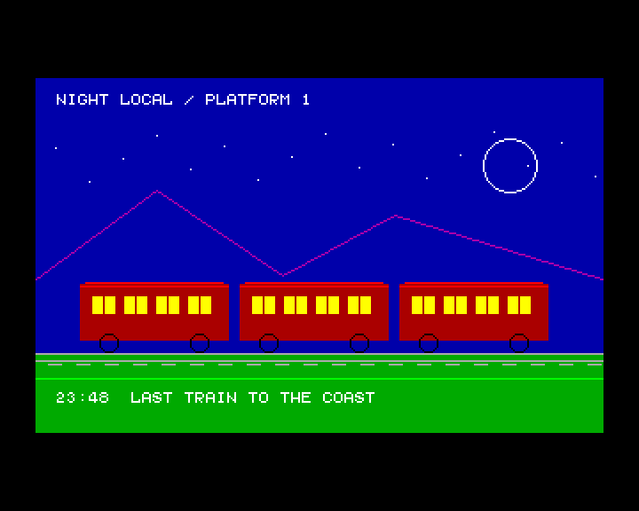
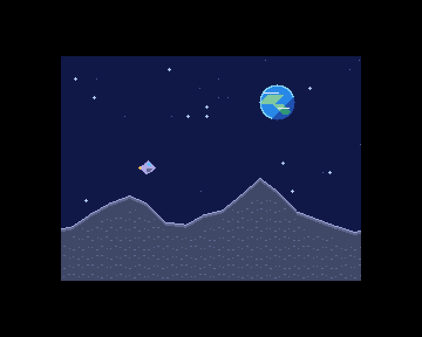

# zxevo-sdk

[](README.md)
[](README.ru.md)

| [BaseConf · Night Train](lib/baseconf/README.ru.md)                                 | [TSConf · Moon Run](lib/tsconf/README.ru.md)                                                                |
| ----------------------------------------------------------------------------------- | ----------------------------------------------------------------------------------------------------------- |
|  |  |

SDK на C и Z80 ASM для приложений ZX Evolution под BaseConf и TSConf. Включает общие API, примеры
для BASIC 48 и тесты в ZEsarUX.

## Аппаратные возможности и API

- **Общее для BaseConf и TSConf** — консоль и графика, выделение страниц RAM и банковая куча,
  частота CPU и прерывания, проигрыватель PT3 и Covox, мышь Kempston, RTC и PS/2, UART и
  низкоуровневый доступ к SD, Nemo IDE и Beta Disk. [Общие модули](lib/common/README.ru.md)
- **BaseConf** поддерживает графику ZX, ZX Multicolor, Pentagon 16 цветов, ATM 320 и ATM 640, а
  также аппаратный текст ATM и Evo 80×25. Специфичные API управляют двумя картами памяти,
  отображением RAM и Flash, палитрами, NewIRQ и оверлеем эмулятора дисковода, вызывают сервисы ROM
  ERS. [Модули BaseConf](lib/baseconf/README.ru.md)
- **TSConf** поддерживает графику ZX, 16- и 256-цветные режимы и аппаратный текст. API управляют
  прокруткой, тайловыми слоями и спрайтами, DMA, страницами памяти и кэшем, растровыми прерываниями,
  джойстиком Kempston и FDDVirt. Есть сервисы FAT из TS-BIOS и модули для расширений Copper, FDR,
  FT812, ZiFi и ZiFi32 при наличии соответствующего оборудования.
  [Модули TSConf](lib/tsconf/README.ru.md)

## Быстрый старт

Для сборки обеих библиотек нужны GNU Make и z88dk с компилятором SDCC и библиотекой classic.

```sh
export PATH="/path/to/z88dk/bin:$PATH"
export ZCCCFG="/path/to/z88dk/lib/config"
make
```

Команда `make examples` собирает TAP для BASIC 48, а `make test` запускает тесты в эмуляторе.
[Загрузка примеров](lib/common/README.ru.md#профиль-запуска-из-basic-48) ·
[Настройка тестов](tools/test_runner/README.ru.md#запуск-тестов)

## Подключение SDK к приложению

Задайте `ZXEVO_SDK_PATH` абсолютным путём к SDK. Подключите в Makefile приложения
`$(ZXEVO_SDK_PATH)/lib/baseconf/baseconf.mk` или `$(ZXEVO_SDK_PATH)/lib/tsconf/tsconf.mk`. Фрагмент
задаёт конфигурацию z88dk, пути к заголовкам и библиотеке и флаги ABI.

Подключите `<zx/version.h>`, чтобы использовать макросы версии при компиляции или получить строку
версии слинкованного SDK через `zx_sdk_version()`.

Перед сборкой приложения решите, кто подготовит окружение, как программа получит управление и что
должно произойти при выходе. Например, при запуске из BASIC 48 нужно сохранить указатель стека и
регистры, необходимые для возврата. При выходе их нужно восстановить и передать управление
интерпретатору. За это отвечает код запуска (`crt0` в z88dk). Он также готовит среду C и вызывает
`main()`. CRT из SDK по умолчанию вызывает `zx_init()` перед `main()` и `zx_shutdown()` при выходе.

- **Штатный Z80 CRT.** Флаги `BASECONF_APP_FLAGS` и `TSCONF_APP_FLAGS` выбирают общий `z80_crt0.asm`
  для самостоятельной программы, которую запускает ваш загрузчик или прошивка. Адрес загрузки, стек
  и прерывания согласуйте с этой средой. По умолчанию программа останавливается после выхода из
  `main()`.
- **BASIC 48.** Переменные `BASECONF_BASIC48_FLAGS` и `TSCONF_BASIC48_FLAGS` выбирают
  `-subtype=basic48`. Добавьте `-create-app`, чтобы получить TAP для команды `LOAD ""`. Загрузчик на
  BASIC читает машинный код с ленты и вызывает его через `RANDOMIZE USR`. Если программа меняла
  карту памяти или прерывания, восстановите окружение BASIC перед возвратом.
- **Свой CRT или запуск без CRT.** Для своего CRT добавьте `-crt0=path/to/crt0.asm` к `*_APP_FLAGS`
  нужной конфигурации. Для сборки без CRT добавьте `--no-crt` и используйте точку входа приложения
  или загрузчика. За стек, подготовку среды C и инициализацию SDK тогда отвечает ваш код запуска.

При сборке TAP флаг `-create-app` вызывает appmake после линковки. Обычный TAP для BASIC 48
загружает один образ. Для загрузки секций в разные страницы RAM есть цели appmake из SDK.
[Упаковка TAP](tools/appmake/README.ru.md)

[Руководство BaseConf](lib/baseconf/README.ru.md) · [Руководство TSConf](lib/tsconf/README.ru.md) ·
[Общие API и запуск из BASIC 48](lib/common/README.ru.md)

## Размер программы

Линковщик берёт из архива объекты, на которые ссылается приложение, вместе с их зависимостями. В SDK
многие функции лежат в отдельных объектах, поэтому неиспользуемый код можно исключить. Некоторые
объекты используют общие подпрограммы или ссылаются сразу на несколько видеобэкендов. Если
приложение работает в определённых видеорежимах, оставьте в библиотеке нужные реализации.
[Параметры BaseConf](lib/baseconf/README.ru.md#выбор-видеорежимов-при-сборке) ·
[Параметры TSConf](lib/tsconf/README.ru.md#выбор-видеорежимов-при-сборке)

- В обоих профилях CRT stdio по умолчанию выключен. Для вывода на экран используйте
  `zx_console_puts()` или `zx_console_printf()`. Для стандартных потоков и `printf()` добавьте
  `-pragma-define:CRT_ENABLE_STDIO=1`. BASIC 48 по умолчанию берёт шрифт 8×8 из ROM.
- Если код использует графический API SDK, вызывайте примитивы `zx_draw_*` напрямую. Вызовы
  классической графики z88dk могут добавить обвязку и вспомогательные функции.
- Соберите приложение с флагом zcc `-m` и вызовите
  `python3 tools/profiling/memory.py program.map --sort size`, чтобы увидеть размеры модулей и
  функций. Процессор видит четыре окна по 16 КиБ. При планировании их раскладки учитывайте код,
  данные, обнуляемую область BSS, стек и отображённые экранные страницы.
  [Отчёт по памяти](tools/profiling/README.ru.md#память)

## Производительность

В SDK отрисовка графики и шрифтов использует подпрограммы на Z80 ASM. Горизонтальные линии и заливка
прямоугольников пишут серии пикселей в формате выбранного режима. Группа графических операций
удерживает отображение экранной памяти между вызовами. На TSConf можно также передавать данные через
DMA и выводить аппаратные спрайты и прокручиваемые тайловые слои.

- Для линий и заливок используйте готовые примитивы. Вызовы к одной поверхности объединяйте через
  `zx_graphics_begin()` и `zx_graphics_end()`. Статический фон можно нарисовать один раз, а в
  анимации обновлять изменившиеся области или двигать аппаратные спрайты и слои TSConf.
  [Night Train](lib/baseconf/examples/night_train.c) · [Moon Run](lib/tsconf/examples/moon_run.c)
- Ищите самые затратные вызовы через `cpu.py`, который считает такты Z80 в ZEsarUX. Сравнивайте
  сборки при одинаковой частоте CPU, видеорежиме и сцене. Для анимации проверяйте, укладывается ли
  всё обновление в интервал между кадрами с учётом звука и обработки ввода.
  [Замеры CPU](tools/profiling/README.ru.md#процессор) ·
  [Замеры вывода шрифтов](lib/baseconf/bench/README.ru.md)

## Инструменты

- [Профилирование](tools/profiling/README.ru.md) описывает `memory.py` для карт линковки и `cpu.py`
  для замеров тактов Z80 в ZEsarUX.
- [Расширение z88dk appmake](tools/appmake/README.ru.md) добавляет загрузчик TAP с банками RAM для
  BaseConf и TSConf.
- [ZXHost и тестовая инфраструктура](tools/test_runner/README.ru.md) загружают программы и собирают
  результаты из ZEsarUX.
- [Форматирование исходников](tools/formatter/README.ru.md) описывает `make format` для C, ASM и
  Markdown.
