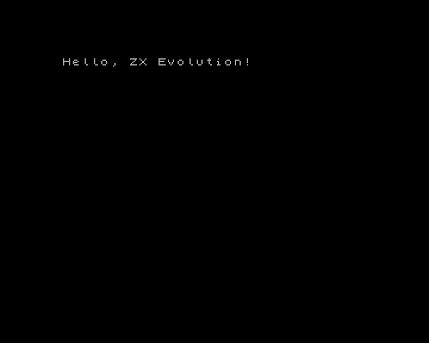
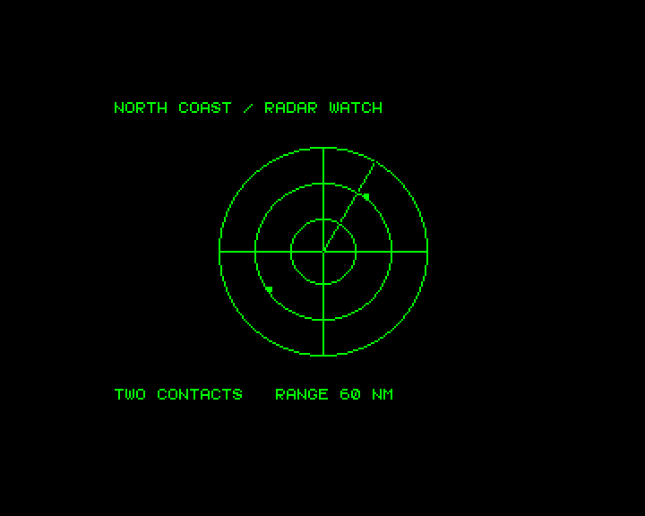
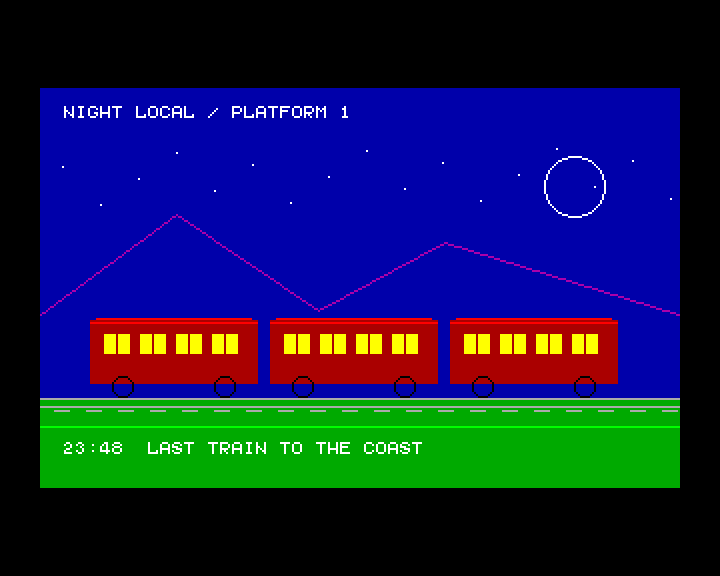

# BaseConf

[](README.en.md)
[](README.ru.md)

| Hello                                                        | Radar                                                                 | Night Train                                                             |
| ------------------------------------------------------------ | --------------------------------------------------------------------- | ----------------------------------------------------------------------- |
|  |  |  |

`lib/baseconf` is a C and Z80 assembly library for ZX Evolution applications running the BaseConf
FPGA profile. It brings together BaseConf memory-map and port access with video modes, graphics,
text, input, RTC/AVR, audio, storage, and selected ERS and interrupt interfaces. PT3 playback is
available through a wrapper around z88dk's Vortex Tracker II player; the module must remain
resident, and the application calls the player at a steady rate.

Public headers are in `lib/baseconf/include/`. The target uses the SDK's shared Z80 CRT.
`baseconf.lib` supplies the standard output hook and the symbols that Spectrum-specific functions in
z88dk's `zx_clib` use to access the ROM and BASIC workspace. The linker pulls those objects in when
the application needs them.

## Requirements and build

You need z88dk with the SDCC compiler and classic library, plus `zcc` and `z88dk-z80asm`. From the
repository root, build the archive with:

```sh
make -C lib/baseconf
```

The output is `lib/baseconf/build/default/baseconf.lib`. Set `ZCC` and `Z80ASM` to override the
tools, and point `ZCCCFG` at the standard z88dk configurations. `Z88DK_SRC` is needed when building
the local appmake. [Appmake requirements](../../tools/appmake/README.en.md)

## Using the library in an application

Include the library's shared makefile from the application's Makefile. It sets the absolute paths to
the target configuration, headers, and archive, along with the matching ABI flags:

```make
ZCC ?= zcc
Z80ASM ?= z88dk-z80asm
include ../lib/baseconf/baseconf.mk

APP_FLAGS := $(BASECONF_APP_FLAGS)
```

Use these flags when building the application. The target configuration selects `-lbaseconf`. Adjust
the Make include path relative to the application directory. The BaseConf configuration relies on
z88dk's standard configuration directory (`ZCCCFG`) for the standard headers and libraries. When
invoking `zcc` directly, set `BASECONF_ROOT` to the absolute `lib/baseconf` path and select
`+<absolute-path>/config/baseconf.cfg`. Add `lib/baseconf/include` and `lib/common/include` to the
include search path.

For a program that returns to BASIC 48, build with `$(BASECONF_BASIC48_FLAGS) -create-app`. Run
`make examples-baseconf` from the repository root to build the examples.
[Shared BASIC 48 profile](../common/README.en.md#basic-48-startup-profile) ·
[Banked TAPs](../../tools/appmake/README.en.md#pack-a-tap)

### Selecting video backends

- `BASECONF_VIDEO_TEXT_MODES` selects console output backends. It accepts `ALL`, `GRAPHICS`, `NONE`,
  or a list of modes such as `ZX_256 ATM_TEXT_80`.
- `BASECONF_VIDEO_PRIMITIVE_MODES` selects drawing backends with the same syntax. `GRAPHICS` selects
  all five bitmap and packed graphics modes. The 80×25 modes support text only.
- `BASECONF_CONSOLE_NO_DEFAULT_FONT=1` drops the console's automatic reference to font8. Select a
  font with `zx_console_set_font()` before output in graphics modes.

For example, build with console output in ZX 256 and ATM hardware text, and drawing in ZX 256.

```sh
make -C lib/baseconf \
  BASECONF_VIDEO_TEXT_MODES="ZX_256 ATM_TEXT_80" \
  BASECONF_VIDEO_PRIMITIVE_MODES=ZX_256 \
  BASECONF_CONSOLE_NO_DEFAULT_FONT=1
```

Rebuild the archive and relink after changing these options. In hardware text modes,
`zx_console_puts()` writes a whole string in one video operation.
[Program size](../../README.md#program-size) · [Performance](../../README.md#performance)

## Initialization and setup

The SDK CRT calls `zx_init()` before `main()`, after the stack and static storage are ready.
Initialization reads the live FPGA state and returns `ZX_UNSAFE_CONTEXT` if the readback probe
fails. The default readback port is BD and the default ERS profile is the service ROM.

The application is responsible for memory maps and screen surfaces. Alongside initialization, an
application can choose an ERS profile with `bc_ers_set_profile()`, override the pinned-window mask
with `bc_set_pinned_windows()`, or report map preparation through `bc_set_maps_prepared()`. By
default, the library derives the pinned mask from code, DATA/BSS, and the current stack.
`bc_set_page_manager_enabled()` enables the pager after both maps are prepared. A request to disable
it returns `ZX_UNSAFE_CONTEXT` because the hardware would replace all RAM windows with ROM. Drawing
pages must be mapped as writable RAM in windows W1–W3. Normal drawing operations do not remap
windows or change memory protection.

For manual startup, for example to choose BE before the first probe, compile with
`-pragma-define:CRT_ENABLE_ZX_LIFECYCLE=0` and call `zx_init()` and `zx_shutdown()` explicitly.
Shutdown returns `ZX_BUSY` while a window lease or graphics group is active. Hardware mappings and
display settings stay in effect, so `zx_init()` can read them again.

If the application needs the page manager, configure both maps and pin every window that must remain
accessible. Then report map readiness and enable the page manager.

```c
bc_set_maps_prepared(1);
if (bc_set_page_manager_enabled(1) != ZX_OK) return 1;
```

## Implemented interfaces

The examples below are independent snippets for an initialized application that includes
`<baseconf.h>`. Memory and build requirements are listed alongside the examples.

### Memory and banking

Use `bc_get_active_map()` to query the active map, `bc_configure_window()` to configure a window in
a selected map, and `bc_window_acquire()` to borrow a window temporarily. Pair each successful
acquisition with `bc_window_release()`. The library maps RAM and Flash banks and controls window
write protection. [memory.h](include/baseconf/memory.h)

The z88dk near heap (`malloc`, `calloc`, `realloc`, `free`) is not initialized by default, so
applications that do not allocate memory avoid the extra startup code. To enable a heap between the
end of BSS and the current stack, set a positive stack reserve:

```c
#pragma output CRT_STACK_SIZE = 512
```

In this mode, `malloc` uses the contiguous free range from the end of BSS to `SP - CRT_STACK_SIZE`.
The value `512` reserves space for the stack; it does not guard against stack overflow, so choose a
value for the application. This only works with RAM that remains continuously accessible at those
addresses. It does not allocate physical banks or switch BaseConf windows.

The `zx_ram_page_pool_t` pool covers physical RAM pages `0..255`, each 16 KiB. Each set bit in its
32-byte mask includes the corresponding page. Construct the mask from the application's memory
layout, leaving pages occupied by the application or system clear. Allocation state is stored inside
`zx_ram_page_pool_t`. Map an allocated page temporarily with `bc_window_acquire()` and
`bc_window_release()`, then return it to the pool with `zx_ram_page_free()`.

Use `zx_ram_heap_t` to allocate objects from that pool. It takes pages from the pool as needed and
uses classic z88dk named heaps within each page. Allocation returns a `zx_ram_heap_ptr_t` handle
(`page + offset`), not a normal C pointer. Call `zx_ram_heap_map()` before reading or writing the
object and `zx_ram_heap_unmap()` when finished. Use an unpinned window W1, W2 or W3. The pointer is
valid only while its window is mapped, and only one lease can be active at a time. Keep the heap,
page storage, mask, pool and dedicated lease in pinned memory outside the window.
`zx_ram_heap_destroy()` returns all backing pages to the pool and invalidates the heap's handles.
Allocation and free return their outcome as `zx_status_t` and attempt to restore the window. Call
`zx_ram_heap_unmap()` afterward. It retries the restore if needed and returns `ZX_OK` if the window
was already restored.

```c
static const zx_ram_page_mask_t page_mask = {
    0xDB, 0xFF, 0xFF, 0xFF, 0xFF, 0xFF, 0xFF, 0xFF
};
static zx_ram_page_pool_t pool;

zx_ram_heap_t heap;
zx_ram_heap_page_t heap_pages[4];
bc_window_lease_t lease;
zx_ram_heap_ptr_t item;
zx_status_t result;
void *address;

/* Enable selected pages below 64. Verify them against the application layout. */
if (zx_ram_page_pool_init(&pool, page_mask) != ZX_OK ||
    bc_ram_heap_init(&heap, &pool, heap_pages, 4, ZX_WINDOW_2, &lease) != ZX_OK) {
    return 1;
}
result = zx_ram_heap_alloc(&heap, 128, &item);
if (zx_ram_heap_unmap(&heap) != ZX_OK) return 1;
if (result != ZX_OK) return 1;

if (zx_ram_heap_map(&heap, item, &address) != ZX_OK) return 1;
((uint8_t *)address)[0] = 42;
if (zx_ram_heap_unmap(&heap) != ZX_OK) return 1;

result = zx_ram_heap_free(&heap, item);
if (zx_ram_heap_unmap(&heap) != ZX_OK) return 1;
if (result != ZX_OK) return 1;
if (zx_ram_heap_destroy(&heap) != ZX_OK) return 1;
```

Flash programming is not implemented.

### Video modes and graphics

The library supports ZX 256, ZX Multicolor, Pentagon 16-color, ATM 320 and ATM 640, plus ATM and Evo
80×25 hardware text modes. Build options select the output modes and graphics primitives available
to the application. Draw pixels, lines, circles and ellipses with SET, CLEAR or XOR. Use
`zx_draw_fill_rect()` and `zx_draw_clear_rect()` for rectangular areas and `zx_read_pixel_index()`
to inspect a pixel on the selected draw surface.

Before changing video modes, prepare both maps and enable the page manager as described above.
`bc_set_video_mode()` maps screen pages into unpinned windows as needed. This example clears and
draws on the currently displayed screen in ZX 256 mode.

```c
if (bc_set_video_mode(BC_VIDEO_ZX_256) != ZX_OK) return 1;
zx_set_ink(7);
zx_set_paper(0);
if (zx_console_clear() != ZX_OK) return 1;
if (zx_graphics_begin() != ZX_OK) return 1;
zx_draw_line(16, 16, 96, 64);
zx_draw_circle(96, 64, 16);
if (zx_graphics_end() != ZX_OK) return 1;
```

For double buffering, map both screens into writable RAM first. `zx_select_draw_screen()` picks the
draw target, and `zx_show_screen()` selects the displayed screen. Use `bc_select_draw_surface()` to
draw to mapped pages in a different format from the displayed mode. In ZX mode, primitives update
the bitmap and preserve the attributes. [video.h](include/baseconf/video.h) ·
[graphics.h](../common/include/zx/graphics.h)

`zx_blit4()` and `zx_blit4_key()` copy linear high-nibble-first 4bpp images to an ATM320 draw
surface. The shared `zx_bitmap4_t` describes pixels, dimensions and byte stride; the keyed call
preserves pixels equal to any index 0..15. Both clip signed coordinates and retain neighbours at odd
edges. Map both writable surface pages before the call and keep the source, code and stack resident
outside them. Window leases cannot be active during drawing: prepare banked images in resident
chunks between completed calls. The routines use direct ASM spans and leave the palette and
ink/paper unchanged. [Shared blit API](../common/include/zx/blit.h)

In z88dk classic, use `#include <games.h>` for software sprites with `putsprite()`, background save
and restore with `bksave()` and `bkrestore()`, and joystick input with `joystick()`. The ZX
implementation of `putsprite()` uses the standard bitmap at `0x4000`. Map the intended screen page
into W1 and keep the routine in writable RAM.
[z88dk games.h](https://github.com/z88dk/z88dk/blob/master/include/games.h)

### Text, fonts and palettes

The console provides cursor-based text in graphics modes and in 80×25 hardware text modes. In
graphics modes, pass `&zx_font8`, `&zx_font5` or a custom descriptor to `zx_console_set_font()`. The
z88dk raw font-pointer IOCTL reports unsupported. `zx_console_printf()` formats strings and 16-bit
integers without stdio. This example uses an archive built with Evo 80×25 text support.

```c
if (bc_set_video_mode(BC_VIDEO_EVO_TEXT_80) != ZX_OK) return 1;
zx_set_ink(7);
zx_set_paper(0);
zx_console_size_t grid;
if (zx_console_clear() != ZX_OK || zx_console_gotoxy(2, 1) != ZX_OK) return 1;
if (zx_console_get_size(&grid) != ZX_OK) return 1;
if (zx_console_printf("Screen: %u x %u", (unsigned)grid.columns, (unsigned)grid.rows) < 0) return 1;
```

Upload a 2 KiB hardware font with `bc_upload_font_to()` or `bc_upload_font_preserving()`. In ZX
modes, `bc_set_ulaplus_palette()` addresses ULAplus entries by index. This example sets color 3 in
the active ZX mode.

```c
if (bc_set_ulaplus_palette(3, 0x9e) != ZX_OK) return 1;
bc_set_ulaplus_enabled(1);
```

Low-level ATM RGB222/RGB444 writes target the color currently under the raster beam.
`bc_palette_load_rgb222()` instead accepts 16 `00RRGGBB` bytes in index order and waits for the
standard frame IRQ before a complete border-selected update. It requires `zx_init`, known AVR window
ownership, RGB222 mode, a Pentagon/60Hz raster and enabled INT with only the standard frame source.
The ISR must return within 1.17 ms; exclude NMI and concurrent palette/raster/paging changes. Active
window/video leases, newirq and synchronized-border 48K/128K rasters are rejected. The loader
restores BF, xx77, FDD and border, and does not write FE audio. The ERS-specific
`bc_ers_set_palette()` remains available for its ROM context. See the full preconditions and
statuses in [palette.h](include/baseconf/palette.h). [console.h](../common/include/zx/console.h) ·
[text.h](include/baseconf/text.h) · [zx/printf.h](../common/include/zx/printf.h) ·
[font.h](include/baseconf/font.h) · [palette.h](include/baseconf/palette.h)

### Mouse and keyboard

For ZX keyboard input, use `#include <input.h>` from z88dk classic. `in_Inkey()` polls for an ASCII
character, and `in_LookupKey()` and `in_KeyPressed()` let you check a specific key or key
combination. [z88dk input.h](https://github.com/z88dk/z88dk/blob/master/include/input.h)

Kempston mouse snapshots provide counters and button bits. `zx_mouse_delta()` handles counter
wraparound. Keep the previous snapshot between polls and poll often enough that motion fits in the
signed delta.

```c
zx_mouse_snapshot_t previous, current;
if (zx_mouse_read(&previous) != ZX_OK) return 1;
/* On the next input tick: */
if (zx_mouse_read(&current) != ZX_OK) return 1;
zx_mouse_delta_t motion = zx_mouse_delta(&previous, &current);
previous = current;
```

The PS/2 API reads physical modifiers and raw scancodes from the AVR log. Establish the current
window with `zx_avr_window_select()` before reading the log. After `ZX_OK`, check for
`ZX_PS2_SCANCODE_EMPTY` and `ZX_PS2_SCANCODE_OVERFLOW`.

```c
uint8_t code;
if (zx_avr_window_select(ZX_AVR_WINDOW_MODES) != ZX_OK) return 1;
if (zx_ps2_scancode_read(&code) != ZX_OK) return 1;
if (code != ZX_PS2_SCANCODE_EMPTY && code != ZX_PS2_SCANCODE_OVERFLOW) {
    /* Pass the byte to the application's scancode decoder. */
}
```

[zx/input.h](../common/include/zx/input.h) · [zx/ps2.h](../common/include/zx/ps2.h)

### RTC, AVR and timing

The RTC API reads date and time as binary or BCD and provides access to clock registers and NVRAM.
The AVR extension window provides firmware metadata, video output settings and EEPROM access. Keep
the window selection stable during an operation, including from NMI. `zx_frame_period()` reports the
nominal frame period in 3.5 MHz T-states regardless of CPU speed.

```c
zx_datetime_t now;
uint32_t frame_tstates;
if (zx_rtc_read_datetime(&now, ZX_RTC_BINARY) != ZX_OK) return 1;
if (zx_avr_window_select(ZX_AVR_WINDOW_MODES) != ZX_OK) return 1;
if (zx_frame_period(&frame_tstates) != ZX_OK) return 1;
```

`zx_set_cpu_speed()` selects 3.5, 7 or 14 MHz. Interrupt support covers saving and restoring INT,
requesting NMI, setting an execution trap, and configuring, querying and acknowledging newirq
sources. The application installs its handlers. [Shared RTC](../common/include/zx/rtc.h) ·
[BaseConf AVR controls](include/baseconf/rtc.h) · [zx/timing.h](../common/include/zx/timing.h) ·
[zx/interrupt.h](../common/include/zx/interrupt.h) ·
[baseconf/interrupt.h](include/baseconf/interrupt.h) · [newirq.h](include/baseconf/newirq.h)

### UART

The UART API configures framing and the divisor, reads line and modem status, and sends and receives
bytes. This example uses 8N1 with divisor 1 and waits up to 4096 polls for one byte. Configure the
peer to match. An expired poll budget returns `ZX_BUSY`.

```c
const zx_uart_config_t config = {ZX_UART_BITS_8, ZX_UART_PARITY_NONE, 1, 1};
uint8_t byte;
if (zx_uart_configure(&config) != ZX_OK) return 1;
zx_status_t received = zx_uart_wait_receive_polls(&byte, 4096);
```

[zx/uart.h](../common/include/zx/uart.h)

### Audio

In z88dk classic, `#include <sound.h>` provides beeper routines such as `bit_beep()` and `bit_fx()`,
plus simple AY melodies with `psg_play()`. Use `#include <psg.h>` for direct control of AY tones,
volume and registers. [z88dk sound.h](https://github.com/z88dk/z88dk/blob/master/include/sound.h) ·
[z88dk psg.h](https://github.com/z88dk/z88dk/blob/master/include/psg.h)

`zx_covox_play(samples, count, delay)` plays unsigned PCM8 and blocks until playback ends. Sample
spacing is `64 + 14*delay` CPU T-states; delay must be 1..255. It leaves CPU/IFF unchanged. For AY,
the library wraps the z88dk PT3 player. Keep the module mapped and call `zx_pt3_play()` once per
music tick. This example assumes one music tick per frame and a frame interrupt as the CPU wake
source.

```c
extern const uint8_t music_pt3[];
uint16_t frame;
if (zx_pt3_init(music_pt3) != ZX_OK) return 1;
zx_pt3_start();
for (frame = 0; frame < 250; ++frame) {
    if (zx_wait_interrupt() != ZX_OK) break;
    zx_pt3_play();
}
zx_pt3_stop();
```

[zx/audio.h](../common/include/zx/audio.h)

### Direct storage access

`zx/ide.h` provides Nemo IDE access, and `baseconf/storage.h` covers SD SPI and VG93. The 512-byte
IDE and SD sector calls issue controller commands directly. The volume selected in ERS has no effect
on them. For VG93, the API covers drive selection, the system port, controller registers and the
hardware overlay mask. [zx/ide.h](../common/include/zx/ide.h)

Nemo IDE supports LBA28 on device 0, IDENTIFY and write-cache flushing. This example reads the first
disk sector. The budget counts ATA status polls.

```c
static uint8_t sector[512];
if (zx_ide_read_sector(0, sector, 60000u) != ZX_OK) return 1;
```

Initialize SD to determine its addressing type. `zx_sd_load()` also reads CID and CSD, and
`zx_sd_sector_count()` decodes capacity from CSD. The FPGA controller uses a fixed SPI clock. The
read budget counts SPI bytes, and the initialization budget counts attempts.

```c
static uint8_t sector[512];
zx_sd_card_type_t card;
if (zx_sd_init(&card, 2000) != ZX_OK) return 1;
if (zx_sd_read_sector(card, 0, sector, 60000u) != ZX_OK) return 1;
```

To read the VG93 status register, exclude NMI and keep the FE overlay mask at zero. Reading
`ZX_FDD_COMMAND` returns controller status.

```c
uint8_t fdd_status;
if (zx_fdd_reg_read(ZX_FDD_COMMAND, &fdd_status) != ZX_OK) return 1;
```

This layer serves the same role as z88dk's `sdcard.h` and `diskio`. Use the word, block and SPI
transaction APIs for custom commands. CSD decoding uses z88dk's `extract_bits`. The ZEsarUX SD test
covers commands, tokens and blocks. Testing full initialization and write-busy release requires a
card model that implements those phases. [SD](../common/include/zx/sd.h) ·
[VG93](../common/include/zx/fdd.h) · [BaseConf floppy controls](include/baseconf/storage.h)

### ERS ROM services

ERS provides ROM-backed storage access. Its device manager and FAT routines work with supported HDD
and SD volumes, and its mounter manages floppy drives and disk images. The library also wraps ROM
version, ERS windows and text, fonts and palette, CMOS, tape, printer and arithmetic services. The
application prepares the ROM, RAM and BASIC state required by `RST 08h`. Check firmware result
fields as well as the wrapper status for storage operations.

This example opens a file at the root of the current FAT partition reported by ERS.

```c
static const char name[16] = "README.TXT";
bc_ers_device_info_t volume;
bc_ers_fat_search_result_t file;
if (bc_ers_device_find(&volume) != ZX_OK || !volume.found) return 1;
if (bc_ers_device_set_volume(volume.current_partition) != ZX_OK) return 1;
if (bc_ers_fat_root_directory() != ZX_OK) return 1;
if (bc_ers_fat_find_short_name(name, &file) != ZX_OK || file.not_found) return 1;
if (bc_ers_fat_open_file() != ZX_OK) return 1;
```

[ers.h](include/baseconf/ers.h) · [rom.h](include/baseconf/rom.h)

## Tests and examples

The test suite is in `lib/baseconf/tests/`. It builds cases and runs them in ZEsarUX with BaseConf
support. Its README describes the case structure and how to run the suite:
`lib/baseconf/tests/README.en.md`. The main command is `make -C lib/baseconf/tests test`.

`make examples-baseconf` from the SDK root builds the BASIC 48 TAPs in
`lib/baseconf/build/examples/`.

- [`hello`](examples/hello.c) sets console colors, clears the ZX screen and prints a greeting.
- [`radar`](examples/radar.c) shows a coastal radar with a frame-paced XOR sweep over a fixed grid.
- [`night_train`](examples/night_train.c) draws a railway scene in ATM 320 on the alternate screen.
  A private drawing stack keeps BASIC's workspace intact. The example pauses for 250 frames, then
  returns to the original ZX screen.

[Startup and launch instructions](../common/README.en.md#basic-48-startup-profile)

## Main headers

- `baseconf.h`, `baseconf/memory.h` — initialization, memory, and maps.
- `baseconf/video.h`, `graphics.h`, `text.h`, `console.h`, `zx/printf.h`, `palette.h`, `font.h` —
  video modes and output.
- `zx/input.h`, `zx/audio.h`, `zx/interrupt.h`, `zx/ide.h` — shared mouse, audio, Z80 interrupt and
  Nemo IDE APIs.
- `zx/ps2.h`, `zx/uart.h` — PS/2 and serial I/O.
- `baseconf/rtc.h`, `timing.h`, `interrupt.h`, `newirq.h` — RTC/AVR, timing and interrupts.
- `baseconf/storage.h`, `rom.h`, `ers.h` — direct storage access and ROM services.
