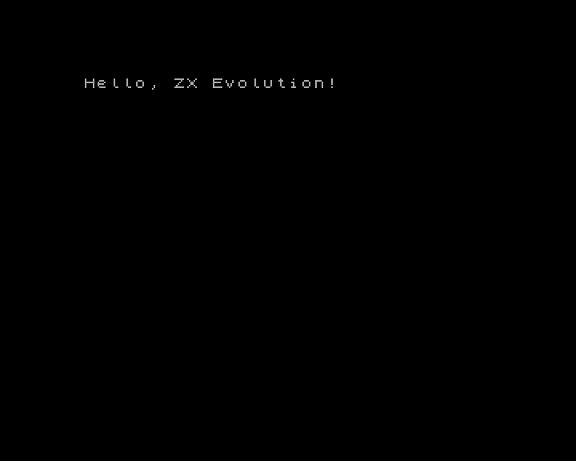
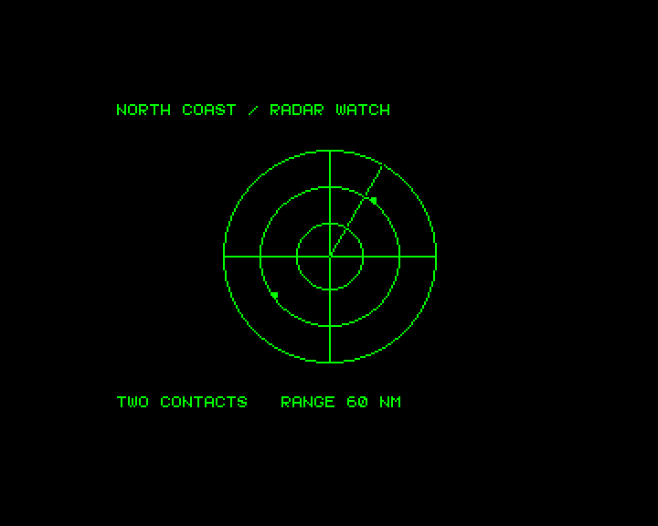
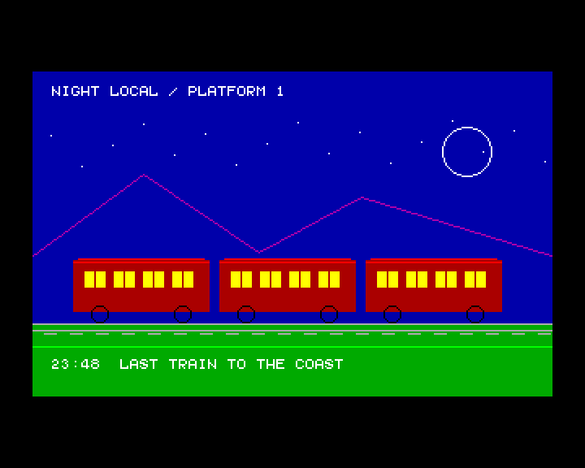

# BaseConf

[](README.en.md)
[](README.ru.md)

| Hello                                                       | Radar                                                              | Night Train                                                            |
| ----------------------------------------------------------- | ------------------------------------------------------------------ | ---------------------------------------------------------------------- |
|  |  |  |

`lib/baseconf` — библиотека на C и Z80 assembler для приложений ZX Evolution, работающих с
FPGA-профилем BaseConf. Она объединяет доступ к карте памяти и портам BaseConf с видеорежимами,
графикой, текстом, вводом, RTC/AVR, звуком, накопителями и выбранными интерфейсами ERS/прерываний.
Для PT3-модулей доступна обёртка над плеером Vortex Tracker II из z88dk: модуль должен оставаться
доступен в памяти, а приложение вызывает плеер с постоянной частотой.

Публичные заголовки находятся в `lib/baseconf/include/`. Конфигурация использует общий Z80 CRT из
SDK. В `baseconf.lib` находятся обработчик стандартного вывода и символы, через которые функции
`zx_clib` обращаются к Spectrum ROM и рабочей области BASIC. Линковщик подключает эти объекты по
мере необходимости.

## Требования и сборка

Нужны z88dk с компилятором SDCC и classic library, а также `zcc` и `z88dk-z80asm`. Из корня
репозитория соберите архив:

```sh
make -C lib/baseconf
```

Результат — `lib/baseconf/build/default/baseconf.lib`. Чтобы выбрать другие инструменты, задайте
`ZCC` и `Z80ASM`. Укажите каталог стандартных конфигураций z88dk в `ZCCCFG`. `Z88DK_SRC` нужен для
сборки локального appmake. [Требования appmake](../../tools/appmake/README.ru.md)

## Подключение к приложению

Добавьте общий make-файл библиотеки в Makefile приложения. Он задаёт абсолютный путь к целевой
конфигурации, заголовкам и архиву, а также согласованные ABI флаги:

```make
ZCC ?= zcc
Z80ASM ?= z88dk-z80asm
include ../lib/baseconf/baseconf.mk

APP_FLAGS := $(BASECONF_APP_FLAGS)
```

При сборке приложения используйте эти флаги. Целевая конфигурация добавляет `-lbaseconf`. Путь
`include` в примере нужно скорректировать относительно каталога приложения. Конфигурация BaseConf
опирается на штатный каталог конфигураций z88dk (`ZCCCFG`), чтобы найти стандартные заголовки и
библиотеки. Для прямого вызова `zcc` задайте `BASECONF_ROOT` как абсолютный путь к `lib/baseconf` и
выберите `+<абсолютный-путь>/config/baseconf.cfg`. Добавьте `lib/baseconf/include` и
`lib/common/include` в пути поиска заголовков.

Для приложения с возвратом в BASIC 48 используйте `$(BASECONF_BASIC48_FLAGS) -create-app`. Команда
`make examples-baseconf` из корня репозитория собирает примеры.
[Общий профиль BASIC 48](../common/README.ru.md#профиль-запуска-из-basic-48) ·
[Банковые TAP](../../tools/appmake/README.ru.md#упаковка-tap)

### Выбор видеорежимов при сборке

- `BASECONF_VIDEO_TEXT_MODES` выбирает реализации консольного вывода. Допустимы `ALL`, `GRAPHICS`,
  `NONE` или список режимов, например `ZX_256 ATM_TEXT_80`.
- `BASECONF_VIDEO_PRIMITIVE_MODES` тем же способом выбирает реализации графических примитивов.
  `GRAPHICS` включает все пять графических режимов. Режимы 80×25 поддерживают только текст.
- `BASECONF_CONSOLE_NO_DEFAULT_FONT=1` убирает автоматическую ссылку консоли на font8. Перед выводом
  в графическом режиме выберите шрифт через `zx_console_set_font()`.

Например, эта сборка оставляет вывод текста в ZX 256 и аппаратном тексте ATM, а графические
примитивы доступны в ZX 256.

```sh
make -C lib/baseconf \
  BASECONF_VIDEO_TEXT_MODES="ZX_256 ATM_TEXT_80" \
  BASECONF_VIDEO_PRIMITIVE_MODES=ZX_256 \
  BASECONF_CONSOLE_NO_DEFAULT_FONT=1
```

После изменения параметров пересоберите архив и перелинкуйте приложение. В аппаратном тексте
`zx_console_puts()` выводит всю строку за одну видеооперацию.
[Размер программы](../../README.ru.md#размер-программы) ·
[Производительность](../../README.ru.md#производительность)

## Инициализация и настройка

CRT вызывает `zx_init()` до `main()`, когда стек и статические данные уже готовы. Инициализация
читает текущее состояние FPGA и возвращает `ZX_UNSAFE_CONTEXT`, если проверка чтения не прошла. По
умолчанию используется порт BD и профиль сервисного ROM ERS.

Приложение отвечает за карты памяти и поверхности экрана. Рядом с инициализацией можно настроить
профиль ERS через `bc_ers_set_profile()`, задать свою маску закреплённых окон через
`bc_set_pinned_windows()` или сообщить о подготовке карт через `bc_set_maps_prepared()`. По
умолчанию маска окон с кодом, DATA/BSS и текущим стеком вычисляется автоматически.
`bc_set_page_manager_enabled()` включает пейджер после подготовки обеих карт. Запрос на отключение
возвращает `ZX_UNSAFE_CONTEXT`, поскольку FPGA подставит ПЗУ во все окна RAM. Страницы рисования
должны быть отображены как доступная для записи RAM в окнах W1–W3. Обычные операции рисования не
переназначают окна и не снимают защиту памяти.

Для ручного запуска, например чтобы выбрать BE до первой проверки, собирайте с
`-pragma-define:CRT_ENABLE_ZX_LIFECYCLE=0` и вызывайте `zx_init()` и `zx_shutdown()` явно. Пока
удерживается окно или открыта группа рисования, `zx_shutdown()` возвращает `ZX_BUSY`. Аппаратные
карты и настройки экрана продолжают действовать, и `zx_init()` может снова их прочитать.

Если приложению нужен менеджер страниц, настройте обе карты и закрепите все окна, которые должны
оставаться доступными. После этого сообщите библиотеке о готовности карт.

```c
bc_set_maps_prepared(1);
if (bc_set_page_manager_enabled(1) != ZX_OK) return 1;
```

## Реализованные интерфейсы

Примеры ниже — фрагменты для инициализированного приложения с `#include <baseconf.h>`. Каждый
фрагмент показывает отдельный сценарий. Условия работы с памятью и требования к профилю сборки
указаны рядом с примерами.

### Память и банки

`bc_get_active_map()` возвращает текущую карту, `bc_configure_window()` настраивает окно выбранной
карты, а `bc_window_acquire()` временно заменяет отображение. Завершайте успешный захват вызовом
`bc_window_release()`. Библиотека умеет отображать RAM и банки Flash и управлять защитой окна от
записи. [memory.h](include/baseconf/memory.h)

Обычная куча z88dk (`malloc`, `calloc`, `realloc`, `free`) по умолчанию не инициализируется: так
приложения без динамического выделения памяти не получают лишний код запуска. Чтобы включить кучу
между концом BSS и текущим стеком, задайте положительный резерв стека:

```c
#pragma output CRT_STACK_SIZE = 512
```

В этом режиме `malloc` использует свободный непрерывный диапазон от конца BSS до адреса
`SP - CRT_STACK_SIZE`. Число `512` — резерв под стек, а не защита от его переполнения; подберите его
под приложение. Этот механизм работает только с RAM, которая постоянно доступна по этому диапазону
адресов. Он не выделяет физические банки и не переключает окна BaseConf.

Пул `zx_ram_page_pool_t` охватывает физические страницы RAM `0..255` размером 16 КиБ. Установленный
бит 32-байтовой маски включает соответствующую страницу. Составьте маску по раскладке памяти,
оставив биты занятых приложением или системой страниц сброшенными. Состояние выделения хранится
внутри `zx_ram_page_pool_t`. Полученную страницу можно временно подключить через
`bc_window_acquire()` и вернуть через `bc_window_release()`, а затем освободить в пуле через
`zx_ram_page_free()`.

Для размещения объектов поверх пула используйте `zx_ram_heap_t`. Она берёт страницы из пула по мере
заполнения предыдущих и использует classic z88dk именованные кучи внутри страниц. Аллокация
возвращает `zx_ram_heap_ptr_t` — пару «страница + смещение», а не обычный указатель. Перед чтением
или записью вызовите `zx_ram_heap_map()`, после работы — `zx_ram_heap_unmap()`. Используйте
незакреплённое окно W1, W2 или W3. Указатель действителен, пока открыто отображение, и одновременно
можно держать открытым только одно окно. Кучу, массив страниц, маску, пул и выделенный lease держите
в закреплённой памяти вне переключаемого окна. Вызов `zx_ram_heap_destroy()` возвращает все страницы
пулу и делает все ссылки этой кучи недействительными. Выделение и освобождение блока возвращают
`zx_status_t` и пытаются восстановить окно. После них вызовите `zx_ram_heap_unmap()`. Функция
повторит восстановление при необходимости и вернёт `ZX_OK`, если окно уже восстановлено.

```c
static const zx_ram_page_mask_t page_mask = {
    0xDB, 0xFF, 0xFF, 0xFF, 0xFF, 0xFF, 0xFF, 0xFF
};
static zx_ram_page_pool_t pool;

zx_ram_heap_t heap;
zx_ram_heap_page_t heap_pages[4];
bc_window_lease_t lease;
zx_ram_heap_ptr_t item;
zx_status_t result;
void *address;

/* Выбраны страницы ниже 64. Проверьте их по раскладке приложения. */
if (zx_ram_page_pool_init(&pool, page_mask) != ZX_OK ||
    bc_ram_heap_init(&heap, &pool, heap_pages, 4, ZX_WINDOW_2, &lease) != ZX_OK) {
    return 1;
}
result = zx_ram_heap_alloc(&heap, 128, &item);
if (zx_ram_heap_unmap(&heap) != ZX_OK) return 1;
if (result != ZX_OK) return 1;

if (zx_ram_heap_map(&heap, item, &address) != ZX_OK) return 1;
((uint8_t *)address)[0] = 42;
if (zx_ram_heap_unmap(&heap) != ZX_OK) return 1;

result = zx_ram_heap_free(&heap, item);
if (zx_ram_heap_unmap(&heap) != ZX_OK) return 1;
if (result != ZX_OK) return 1;
if (zx_ram_heap_destroy(&heap) != ZX_OK) return 1;
```

Программирование Flash не реализовано.

### Видеорежимы и графика

Библиотека поддерживает ZX 256, ZX Multicolor, Pentagon 16 цветов, ATM 320 и ATM 640, а также
аппаратные текстовые режимы ATM и Evo 80×25. Режимы вывода и графические примитивы включаются
настройками сборки. Графический API рисует точки, линии, окружности и эллипсы с операциями SET,
CLEAR и XOR. `zx_draw_fill_rect()` и `zx_draw_clear_rect()` работают с прямоугольными областями, а
`zx_read_pixel_index()` читает пиксель выбранной поверхности.

Для смены видеорежима подготовьте карты и включите менеджер страниц, как описано выше.
`bc_set_video_mode()` подбирает отображение экранных страниц в незакреплённых окнах. Пример очищает
текущий видимый экран и рисует на нём в режиме ZX 256.

```c
if (bc_set_video_mode(BC_VIDEO_ZX_256) != ZX_OK) return 1;
zx_set_ink(7);
zx_set_paper(0);
if (zx_console_clear() != ZX_OK) return 1;
if (zx_graphics_begin() != ZX_OK) return 1;
zx_draw_line(16, 16, 96, 64);
zx_draw_circle(96, 64, 16);
if (zx_graphics_end() != ZX_OK) return 1;
```

Для двойной буферизации заранее отобразите страницы обоих экранов как доступную для записи RAM.
`zx_select_draw_screen()` выбирает, куда рисовать, а `zx_show_screen()` переключает видимый экран.
Через `bc_select_draw_surface()` можно рисовать в отображённые страницы другого формата. В режиме ZX
графические примитивы меняют битовую карту, сохраняя атрибуты. [video.h](include/baseconf/video.h) ·
[graphics.h](../common/include/zx/graphics.h)

В classic z88dk подключите `#include <games.h>` для вывода программных спрайтов через `putsprite()`,
сохранения и восстановления фона через `bksave()` и `bkrestore()`, а также опроса джойстика через
`joystick()`. Реализация `putsprite()` для ZX работает со стандартной битовой картой по адресу
`0x4000`. Для неё отобразите нужную страницу экрана в W1 и держите код процедуры в доступной для
записи RAM. [games.h в z88dk](https://github.com/z88dk/z88dk/blob/master/include/games.h)

### Текст, шрифты и палитры

`zx_console_*` выводит текст с курсором как в графике, так и в режимах 80×25. Для графики передайте
`&zx_font8`, `&zx_font5` или собственный дескриптор в `zx_console_set_font()`. IOCTL z88dk для
установки указателя на шрифт возвращает ошибку. `zx_console_printf()` форматирует строки и 16-битные
целые без stdio. Пример использует сборку с поддержкой текста Evo 80×25.

```c
if (bc_set_video_mode(BC_VIDEO_EVO_TEXT_80) != ZX_OK) return 1;
zx_set_ink(7);
zx_set_paper(0);
zx_console_size_t grid;
if (zx_console_clear() != ZX_OK || zx_console_gotoxy(2, 1) != ZX_OK) return 1;
if (zx_console_get_size(&grid) != ZX_OK) return 1;
if (zx_console_printf("Screen: %u x %u", (unsigned)grid.columns, (unsigned)grid.rows) < 0) return 1;
```

Аппаратный шрифт загружается из таблицы в 2 КиБ через `bc_upload_font_to()` или
`bc_upload_font_preserving()`. Палитра ULAplus в режимах ZX адресуется по индексу через
`bc_set_ulaplus_palette()`. Пример задаёт цвет для индекса 3 в активном режиме ZX.

```c
if (bc_set_ulaplus_palette(3, 0x9e) != ZX_OK) return 1;
bc_set_ulaplus_enabled(1);
```

Запись ATM RGB222/RGB444 выбирает цвет по текущему положению луча, поэтому приложение синхронизирует
запись с растром. [console.h](../common/include/zx/console.h) · [text.h](include/baseconf/text.h) ·
[zx/printf.h](../common/include/zx/printf.h) · [font.h](include/baseconf/font.h) ·
[palette.h](include/baseconf/palette.h)

### Мышь и клавиатура

Для клавиатуры ZX подключите `#include <input.h>` из classic z88dk. `in_Inkey()` опрашивает
клавиатуру и возвращает ASCII-код, а `in_LookupKey()` и `in_KeyPressed()` позволяют проверить
конкретную клавишу или комбинацию.
[input.h в z88dk](https://github.com/z88dk/z88dk/blob/master/include/input.h)

Kempston возвращает счётчики мыши и маску кнопок. `zx_mouse_delta()` учитывает переполнение
счётчиков. Сохраняйте предыдущий снимок между опросами и опрашивайте мышь достаточно часто, чтобы
перемещение помещалось в знаковую разность.

```c
zx_mouse_snapshot_t previous, current;
if (zx_mouse_read(&previous) != ZX_OK) return 1;
/* При следующем опросе: */
if (zx_mouse_read(&current) != ZX_OK) return 1;
zx_mouse_delta_t motion = zx_mouse_delta(&previous, &current);
previous = current;
```

PS/2 API читает физические модификаторы и сырые скан-коды из журнала AVR. Перед чтением журнала
установите известное окно через `zx_avr_window_select()`. После `ZX_OK` проверяйте
`ZX_PS2_SCANCODE_EMPTY` и `ZX_PS2_SCANCODE_OVERFLOW`.

```c
uint8_t code;
if (zx_avr_window_select(ZX_AVR_WINDOW_MODES) != ZX_OK) return 1;
if (zx_ps2_scancode_read(&code) != ZX_OK) return 1;
if (code != ZX_PS2_SCANCODE_EMPTY && code != ZX_PS2_SCANCODE_OVERFLOW) {
    /* Передайте байт декодеру скан-кодов приложения. */
}
```

[zx/input.h](../common/include/zx/input.h) · [zx/ps2.h](../common/include/zx/ps2.h)

### RTC, AVR и тайминг

RTC API читает дату и время в двоичном формате или BCD и даёт доступ к регистрам часов и NVRAM.
Через окно расширения AVR доступны метаданные прошивки, настройки видеовыхода и EEPROM. Выбор окна
должен оставаться стабильным во время операции, в том числе в обработчике NMI. `zx_frame_period()`
возвращает номинальную длительность кадра в тактах 3,5 МГц независимо от выбранной скорости CPU.

```c
zx_datetime_t now;
uint32_t frame_tstates;
if (zx_rtc_read_datetime(&now, ZX_RTC_BINARY) != ZX_OK) return 1;
if (zx_avr_window_select(ZX_AVR_WINDOW_MODES) != ZX_OK) return 1;
if (zx_frame_period(&frame_tstates) != ZX_OK) return 1;
```

`zx_set_cpu_speed()` выбирает 3,5, 7 или 14 МГц. Для управления прерываниями доступны сохранение и
восстановление INT, запрос NMI, ловушка исполнения и операции newirq для маски, статуса и
подтверждения источников. Обработчики устанавливает приложение.
[Общий RTC](../common/include/zx/rtc.h) · [Настройки AVR BaseConf](include/baseconf/rtc.h) ·
[zx/timing.h](../common/include/zx/timing.h) · [zx/interrupt.h](../common/include/zx/interrupt.h) ·
[baseconf/interrupt.h](include/baseconf/interrupt.h) · [newirq.h](include/baseconf/newirq.h)

### UART

UART API задаёт формат кадра и делитель, читает состояние линии и модема, отправляет и принимает
байты. Пример настраивает 8N1 с делителем 1 и ждёт байт не более 4096 опросов. Настройте другую
сторону соединения на те же параметры. Исчерпание бюджета возвращает `ZX_BUSY`.

```c
const zx_uart_config_t config = {ZX_UART_BITS_8, ZX_UART_PARITY_NONE, 1, 1};
uint8_t byte;
if (zx_uart_configure(&config) != ZX_OK) return 1;
zx_status_t received = zx_uart_wait_receive_polls(&byte, 4096);
```

[zx/uart.h](../common/include/zx/uart.h)

### Звук

В classic z88dk заголовок `#include <sound.h>` даёт функции бипера (`bit_beep()`, `bit_fx()`) и
проигрывание простых мелодий на AY через `psg_play()`. Для управления тонами, громкостью и
регистрами AY подключите `#include <psg.h>`.
[sound.h в z88dk](https://github.com/z88dk/z88dk/blob/master/include/sound.h) ·
[psg.h в z88dk](https://github.com/z88dk/z88dk/blob/master/include/psg.h)

`zx_covox_play()` блокирующе воспроизводит упакованные 4-битные сэмплы, начиная со старшей половины
байта. Для AY библиотека оборачивает PT3-плеер z88dk. Модуль должен оставаться доступен в памяти, а
приложение вызывает `zx_pt3_play()` один раз за музыкальный тик. Пример подходит для модуля с одним
тиком на кадр, если CPU просыпается от кадрового INT.

```c
extern const uint8_t music_pt3[];
uint16_t frame;
if (zx_pt3_init(music_pt3) != ZX_OK) return 1;
zx_pt3_start();
for (frame = 0; frame < 250; ++frame) {
    if (zx_wait_interrupt() != ZX_OK) break;
    zx_pt3_play();
}
zx_pt3_stop();
```

[zx/audio.h](../common/include/zx/audio.h)

### Прямой доступ к накопителям

`zx/ide.h` даёт доступ к Nemo IDE, а `baseconf/storage.h` — к SD SPI и ВГ93. Операции с 512-байтными
секторами IDE и SD выполняют команды контроллера напрямую. Выбор тома в ERS на них не влияет. Для
ВГ93 доступны выбор дисковода, системный порт, регистры контроллера и маска аппаратного перехвата.
[zx/ide.h](../common/include/zx/ide.h)

Nemo IDE поддерживает LBA28 для устройства 0, IDENTIFY и сброс кэша записи. Этот пример читает
первый сектор диска. Бюджет задан в опросах статуса ATA.

```c
static uint8_t sector[512];
if (zx_ide_read_sector(0, sector, 60000u) != ZX_OK) return 1;
```

Для SD сначала определите тип адресации. `zx_sd_load()` дополнительно читает CID и CSD, а
`zx_sd_sector_count()` извлекает ёмкость из CSD. Контроллер FPGA использует фиксированную частоту
SPI. Бюджет чтения задан в байтах SPI, бюджет инициализации — в попытках.

```c
static uint8_t sector[512];
zx_sd_card_type_t card;
if (zx_sd_init(&card, 2000) != ZX_OK) return 1;
if (zx_sd_read_sector(card, 0, sector, 60000u) != ZX_OK) return 1;
```

Для чтения регистра статуса ВГ93 исключите NMI и оставьте маску FE-перехвата нулевой. При чтении
`ZX_FDD_COMMAND` возвращается статус контроллера.

```c
uint8_t fdd_status;
if (zx_fdd_reg_read(ZX_FDD_COMMAND, &fdd_status) != ZX_OK) return 1;
```

По назначению этот слой соответствует `sdcard.h` и `diskio` из z88dk. Для собственных команд есть
API слов, блоков и SPI-транзакций. Поля CSD извлекает `extract_bits` из z88dk. Тест SD в ZEsarUX
покрывает команды, токены и блоки. Для проверки полной инициализации и освобождения busy после
записи нужна модель карты, которая воспроизводит эти фазы. [SD](../common/include/zx/sd.h) ·
[ВГ93](../common/include/zx/fdd.h) · [Настройки дисковода BaseConf](include/baseconf/storage.h)

### Сервисы ПЗУ ERS

ERS уже предоставляет доступ к накопителям через ПЗУ. Менеджер устройств и функции FAT работают с
поддерживаемыми томами HDD и SD, а монтировщик управляет дисководами и образами дискет. Есть также
обёртки для версии ROM, окон и текста ERS, шрифтов и палитры, CMOS, ленты, принтера и арифметики.
Приложение должно подготовить ROM, RAM и состояние BASIC для `RST 08h`. Обёртки возвращают результат
вызова, а операции с накопителями дополнительно возвращают статус самой прошивки.

Пример открывает файл в корне FAT-раздела, выбранного ERS при обнаружении устройств.

```c
static const char name[16] = "README.TXT";
bc_ers_device_info_t volume;
bc_ers_fat_search_result_t file;
if (bc_ers_device_find(&volume) != ZX_OK || !volume.found) return 1;
if (bc_ers_device_set_volume(volume.current_partition) != ZX_OK) return 1;
if (bc_ers_fat_root_directory() != ZX_OK) return 1;
if (bc_ers_fat_find_short_name(name, &file) != ZX_OK || file.not_found) return 1;
if (bc_ers_fat_open_file() != ZX_OK) return 1;
```

[ers.h](include/baseconf/ers.h) · [rom.h](include/baseconf/rom.h)

## Тесты и примеры

Тест-сьют находится в `lib/baseconf/tests/`. Он собирает кейсы и запускает их в ZEsarUX с поддержкой
BaseConf; подробности, устройство кейсов и способы запуска описаны в
`lib/baseconf/tests/README.ru.md`. Основная команда запуска — `make -C lib/baseconf/tests test`.

`make examples-baseconf` из корня SDK собирает TAP для BASIC 48 в `lib/baseconf/build/examples/`.

- [`hello`](examples/hello.c) задаёт цвета консоли, очищает ZX-экран и выводит приветствие.
- [`radar`](examples/radar.c) показывает береговой радар. Луч движется по кадрам, а повторный XOR
  восстанавливает сетку и отметки целей.
- [`night_train`](examples/night_train.c) рисует ночной поезд на втором экране ATM 320. Отдельный
  стек для рисования сохраняет рабочую область BASIC. Через 250 кадров пример возвращается к
  исходному ZX-экрану.

[Профиль и загрузка TAP](../common/README.ru.md#профиль-запуска-из-basic-48)

## Основные заголовки

- `baseconf.h`, `baseconf/memory.h` — инициализация, память и карты.
- `baseconf/video.h`, `graphics.h`, `text.h`, `console.h`, `zx/printf.h`, `palette.h`, `font.h` —
  видеорежимы и вывод.
- `zx/input.h`, `zx/audio.h`, `zx/interrupt.h`, `zx/ide.h` — общие API мыши, звука, прерываний Z80 и
  Nemo IDE.
- `zx/ps2.h`, `zx/uart.h` — PS/2 и последовательный порт.
- `baseconf/rtc.h`, `timing.h`, `interrupt.h`, `newirq.h` — RTC/AVR, тайминг и прерывания.
- `baseconf/storage.h`, `rom.h`, `ers.h` — прямой доступ к накопителям и сервисы ПЗУ.
