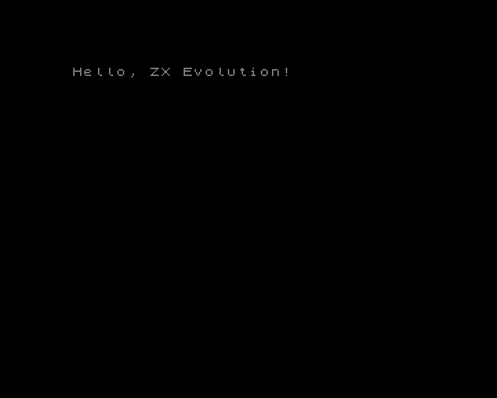
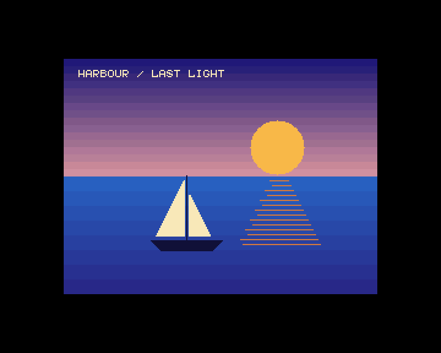
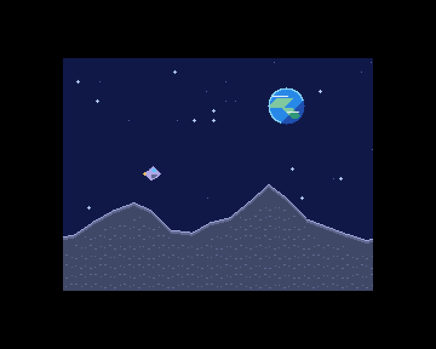

# TSConf library

[](README.en.md)
[](README.ru.md)

| Hello                                                        | Harbour                                                                     | Moon Run                                                                                   |
| ------------------------------------------------------------ | --------------------------------------------------------------------------- | ------------------------------------------------------------------------------------------ |
|  |  |  |

`tsconf.lib` is a Z80 archive for z88dk's classic SDCC ABI. The register, video and DMA APIs use the
TSConf hardware directly. The TS-FAT API calls the stock TS-BIOS. Include `tsconf.h` for the public
API. [Public header](include/tsconf.h)

```sh
make tsconf-lib
make examples-tsconf
make test-tsconf
```

## Building applications

Include `lib/tsconf/tsconf.mk` from an application Makefile. Use `$(TSCONF_APP_FLAGS)` for the
project target with the shared Z80 CRT, or `$(TSCONF_BASIC48_FLAGS) -create-app` for the BASIC 48
TAP profile. For direct zcc invocation, use the `tsconf.cfg` generated next to `tsconf.lib` by the
library build. With the default build directory, pass
`+<absolute-path-to-zxevo-sdk>/lib/tsconf/build/default/tsconf.cfg`. Keep `ZCCCFG` pointed at
z88dk's standard configs, pass the archive directory with `-L`, and include both
`lib/tsconf/include` and `lib/common/include`. The generated config supports `-subtype=basic48` and
includes paths to the SDK CRT and appmake. Run `make appmake` in the SDK before packaging a TAP
directly with zcc. [Shared Make settings](tsconf.mk)

To build a BASIC 48 TAP in another project, first build the archive with
`make -C /path/to/zxevo-sdk tsconf-lib`. Pass `ZXEVO_SDK_PATH=/path/to/zxevo-sdk` to the
application's Makefile.

```makefile
.DEFAULT_GOAL := demo.tap
include $(ZXEVO_SDK_PATH)/lib/tsconf/tsconf.mk

demo.tap: main.c $(TSCONF_LIB) $(ZX_APPMAKE_BIN)
	$(ZCC) $(TSCONF_BASIC48_FLAGS) -m -create-app -o demo main.c
```

The archive can also be used with another target or an application-supplied entry point. Link it
with `-ltsconf` and use the classic SDCC ABI (`-clib=classic -compiler=sdcc --reserve-regs-iy`). The
linker resolves hardware-backed `zx_` symbols such as `zx_set_border_color()` once per executable.
Their implementation is fixed even if the executable links both platform archives.

[Banked TAPs](../../tools/appmake/README.en.md#pack-a-tap)

### Selecting video backends

`TSCONF_VIDEO_MODES` selects the console and drawing backends when building `tsconf.lib`. It
defaults to `ALL` and accepts a space-separated list of `ZX`, `16C`, `256C` and `TEXT`. For a
ZX-only application:

```sh
make -C lib/tsconf TSCONF_VIDEO_MODES=ZX
```

Use `TSCONF_BUILD` to keep different archive profiles in separate directories. Surface selection and
`ts_video_set_mode` reject excluded draw modes. Direct video register setters remain available. An
application that uses console output or drawing can omit the other backends this way.

Build with `TSCONF_VIDEO_60HZ=1` when the FPGA uses its optional 60 Hz timing. This defines the
software geometry for the archive. The FPGA timing is configured separately. The `360×288` raster
then has 240 active lines.

### BASIC 48 startup profile

`make examples-tsconf` builds the BASIC 48 TAPs in `lib/tsconf/build/examples/`.

- [`hello`](examples/hello.c) selects the standard ZX screen and prints a greeting.
- [`harbour`](examples/harbour.c) paints a sailboat at sunset in 256-color mode with a custom RGB555
  palette, a sky gradient and reflections.
- [`moon_run`](examples/moon_run.c) flies a hardware sprite over a lunar landscape. Two tile layers
  scroll at different speeds to create parallax.

The extended scenes use scratch RAM pages above `3Fh` and leave the ZX palette in bank F available
when they return to BASIC.
[Startup and launch instructions](../common/README.en.md#basic-48-startup-profile)

## Hardware APIs

- `zx_get_cpu_speed` and `zx_set_cpu_speed` use the settings recorded by the SDK because SysConfig
  and CacheConfig are write-only. Set initial settings with `ts_set_cpu_speed_and_cache` or
  `ts_io_set_system_config`. Use `ts_memory_set_cache` for a per-window mask. `zx_set_cpu_speed`
  preserves that mask. After an external ROM or port write, set the settings through the SDK again.
  The TS-FAT wrappers record the ROM's clock change.
  [Shared timing API](../common/include/zx/timing.h)
- `ts_io_read_status` reads Status and `ts_io_set_interrupt_mask` selects IRQ sources.
- `ts_irq_set_frame_position` programs the raster compare. `zx_frame_period` reports its build's
  nominal period in 3.5 MHz T-states. To wait for a frame while other IRQs are enabled, increment a
  resident byte in the frame ISR and pass it to `zx_wait_frame`.
  [Timing API](include/tsconf/timing.h)
- The shared `zx_uart_*` API drives the Kondratyev UART at `F8EF–FFEF`.
  [UART header](../common/include/zx/uart.h)
- `zx_rtc_*`, `zx_nvram_*`, `zx_eeprom_*` and `zx_ps2_*` use the indexed GlukClock ports. Call
  `ts_rtc_set_enabled(1)` before using them. Establish the AVR extension with `zx_avr_window_select`
  before reading a version record or the PS/2 log. [Shared RTC](../common/include/zx/rtc.h) ·
  [TSConf RTC controls](include/tsconf/rtc.h) · [PS/2 API](../common/include/zx/ps2.h)
- `ts_joystick_read` reads Kempston with Beta Disk ports closed. `ts_fdd_set_config` configures
  FDDVirt. Use `zx_fdd_*` for Beta Disk registers with a physical drive selected.
  [Input API](include/tsconf/input.h) · [FDD API](../common/include/zx/fdd.h)
- `ts_memory_set_page0` through `ts_memory_set_page3` map the CPU windows. `ts_memory_set_config`
  selects ROM or RAM in W0, and `ts_memory_set_cache` controls cache enables per window. Page2 and
  Page3 also have getters.
- The shared headers provide PT3, Covox, Kempston mouse, Z80 interrupt control and Nemo IDE PIO on
  `IDE_HDD` builds. [Shared APIs](../common/README.en.md)
- `ts_map_ram_page` maps RAM into W1–W3 and returns a `zx_status_t`. Pair `ts_window_acquire` with
  `ts_window_release` for temporary mappings in W2 or W3, where the current page can be read back.
  Keep the lease, code, stack and needed data outside the borrowed window. Serialize it with
  TS-BIOS, packed drawing and direct paging writes.
- Use the common `zx_ram_page_pool_init` and `zx_ram_page_alloc` for physical RAM pages. Call
  `ts_ram_heap_init` with a dedicated `ts_window_lease_t` to bind a common banked heap to W2 or W3.
  Allocation, mapping, unmapping, freeing and destruction use `zx_ram_heap_*`.
  [Common memory API](../common/include/zx/memory.h)
- `ts_video_set_config`, `ts_video_set_page` and `ts_video_set_scroll` set the display mode, base
  page and nine-bit graphics offsets. The video header also provides setters for PalSel, Border,
  TSConfig and SGPage.
- Map FMAPS over disposable backing memory with `ts_fmaps_enable`. Upload CRAM colors and SFILE
  descriptors with `ts_fmaps_write_words`, then call `ts_fmaps_disable`. Coordinate access with
  interrupt handlers and DMA.
- `ts_dma_start`, `ts_dma_busy` and `ts_dma_wait` control DMA independently of ROM. Start with an
  idle engine and use uncached CPU mappings for DMA buffers. The transfer descriptor uses physical
  pages and even byte offsets. Encode the words per burst and the number of bursts as the respective
  count minus one. `ts_dma_wait_polls` bounds the number of status reads. The control constants name
  the device, blit and internal-file modes. `ts_dma_configure_wait_port` sets the AVR endpoint and
  `ts_dma_start_extended` programs the upper burst bits on FDR builds.
  [DMA API](include/tsconf/dma.h)

## Text output and drawing

The console and drawing primitives share a draw surface. `zx_init()` has no setup to do on TSConf.
`zx_shutdown()` discards the software draw target once all window leases and graphics groups have
ended. The display keeps its current settings. Use `ts_video_set_mode` to set up the display and
draw to the same surface, `ts_video_select_draw_screen` to select a page in the last configured
display layout, or `ts_video_select_draw_surface` for a page with its own layout. The raw
`ts_video_set_config` and `ts_video_set_page` calls affect the display and leave the draw surface
selected, so you can flip between prepared pages. For the standard ZX screens, `zx_show_screen`
displays page 5 or 7 at a scanline boundary. Set the write-only VConfig through the library before
using `ts_video_select_draw_screen` or `zx_show_screen`.

`zx_graphics_get_size` reports pixel bounds on the selected draw surface, and
`ts_video_get_raster_size` reports the native TSConf display area from the last VConfig written
through the library. Text mode doubles the raster width in pixels. `zx_console_get_size` reports the
usable columns and rows for the selected surface and font. At 60 Hz the largest text and packed
console grids use 30 rows.

With stdio enabled via `-pragma-define:CRT_ENABLE_STDIO=1`, `printf()` writes to the selected
surface in both profiles. `zx_console_puts()` writes a string at the cursor and
`zx_console_printf()` formats strings and 16-bit integers without requiring stdio.
[zx/printf.h](../common/include/zx/printf.h)

The caller maps a ZX or native text page before selecting it and keeps the mapping during output.
With W3 free and the ZX palette already set:

```c
ts_video_set_scroll(0, 0);
ts_memory_set_page3(0x60);
if (ts_video_set_mode(TS_VIDEO_ZX | TS_VIDEO_256X192 | TS_VIDEO_HIDE_TSU,
                      0x60, (volatile void *)0xc000) != ZX_OK) return 1;
zx_console_printf("TSConf %d\n", 48);
zx_draw_line(16, 16, 96, 64);
```

Native text stores 128 character bytes and 128 attribute bytes per row. Map the font page
`surface.page ^ 1` and call `ts_console_load_text_font` to install the default ASCII glyphs. Then
map and select the text page. The console takes its grid size from the selected surface's raster. In
ZX and packed modes, pass `&zx_font8`, `&zx_font5` or a custom descriptor to `zx_console_set_font`.
Use `zx_set_ink` and `zx_set_paper` to set the console colors. These values persist across
draw-surface changes. The console uses canvas coordinates starting at the origin.

`zx_console_clear` clears the selected surface and homes the cursor. In 16c/256c it fills the entire
512×512 canvas with paper. Use `zx_draw_fill_rect` or `zx_draw_clear_rect` for an area of the bitmap
or canvas. In ZX, these set or clear bitmap bits and preserve attributes. `zx_read_pixel_index`
reads the selected bitmap or packed canvas in the same coordinates. In ZX it reports ink or paper
with BRIGHT, independent of the FLASH phase. Packed access borrows W3 and restores its mapping. Keep
the program, data, stack and active interrupt handlers outside W3 when drawing to a packed canvas.
The shared `zx_draw_*` primitives support SET, CLEAR and XOR. Packed drawing uses the current ink
and paper. Group calls with `zx_graphics_begin` and `zx_graphics_end` to hold W3 across multiple
packed operations. `zx_console_draw` draws at cell coordinates without moving the cursor. Enable
automatic one-row scrolling with `ts_console_set_autoscroll(1)`. Packed scrolling uses up to 360
extra stack bytes. [Shared console API](../common/include/zx/console.h) ·
[Native text options](include/tsconf/console.h) ·
[Shared graphics API](../common/include/zx/graphics.h)

## Tile layers

Both 64×64 tile maps share the physical page selected by `ts_video_set_tile_map_page`. Each layer
has its own 512×512 packed 4bpp atlas and nine-bit X and Y offsets. Each atlas starts on an
eight-page boundary. After loading the atlas and palette, initialize the map and write entries while
the layer is hidden. For example, with W3 available for the map, place tile 65 at column 3, row 2 of
layer 0.

```c
ts_video_set_tile_map_page(0x60);
ts_video_set_tile0_page(0x48);
ts_memory_set_page3(0x60);
ts_video_write_tile((volatile void *)0xc000, 0, 3, 2, TS_TILE_ENTRY(65, 2) | TS_TILE_FLIP_X);
ts_video_set_tile0_scroll(0, 0);
ts_video_set_tsu_config(TS_TSU_TILE0);
```

The entry selects local palette 2 within T0's PalSel group. Pixel index 0 is transparent. An entry
with tile index 0 is skipped unless the layer's `TS_TSU_TILE0_INDEX0` or `TS_TSU_TILE1_INDEX0` bit
is set.

## SD SPI and TS-FAT

The direct SD1 API initializes cards, reads CID/CSD/OCR and reads or writes physical sectors without
TS-BIOS. `zx_sd_begin` and `zx_sd_end` enclose explicit command and data transfers. Serialize with
other SPI users. [Shared SD API](../common/include/zx/sd.h)

Disable interrupts before mapping logical ROM page 0 into W0. Call `ts_memory_set_page0(0)` and
`ts_memory_set_config(TS_MEM_W0_DIRECT)`. Keep VDOS and DivMMC inactive so `RST 10h` reaches
TS-BIOS. Reserve physical RAM page `F7h`. The ROM maps it into W2 (`8000h–BFFFh`) for its workspace
and private stack. Put caller code, the return stack and the filename record outside W2. TS-BIOS
restores Page2 and SP on return. It sets SysConfig to `02h` (14 MHz, caches disabled) and leaves
maskable interrupts disabled.

With DMA idle and exclusive access to the ROM stream and SD interface, call `ts_fat_mount_sd()`,
then `ts_fat_open()` with a zero type byte and an uppercase short filename in the root of the FAT32
volume. Both return `ZX_OK` on success or `ZX_IO_ERROR` if the ROM reports a failure. The open call
returns the file length through its output pointer. `ts_fat_read_sector()` reads into a physical RAM
page at an even offset and advances the ROM cursor after a successful transfer. Use the length to
stop at EOF and to count the valid bytes in the final sector. The ROM overwrites the READ512 status
during return and may block waiting for the SD card. The API also mounts Nemo IDE, enters
directories, returns to the root, rewinds or skips sectors, and creates, deletes and writes files.
Enable the frame IRQ source before mounting IDE. To mount an IDE slave, use a TS-BIOS ROM with the
LBA drive selector fix. WRITE512 has the same ROM status limitation as READ512.
[TS-FAT header](include/tsconf/fat.h)

## Expansion interfaces

`ts_spi_*` exposes the shared TSConf SPI selector and byte pipeline. `ts_zifi_*` works with the
AVR's legacy ZiFi and enhanced RS-232 FIFOs, including RX events. `ts_copper_*` uploads and starts
lists on COPPER builds, and `ts_fdr_*` controls capture and reads the count on FDR builds.
`ts_ft812_*` provides host commands, EVE memory transfers, display timing, display-list swaps and
external video routing on VDAC2. `ts_zifi32_*` provides ESP32 SPI registers, firmware commands and
aligned bulk transfers. The caller serializes SPI use across these devices and SD.
[SPI](include/tsconf/spi.h) · [ZiFi](include/tsconf/zifi.h) · [Copper](include/tsconf/copper.h) ·
[FDR](include/tsconf/fdr.h) · [FT812](include/tsconf/ft812.h) · [ZiFi32](include/tsconf/zifi32.h)

## Emulator tests

The suite uses the shared test harness and ZXHost on ZEsarUX's **TSConf** machine. It leaves W1
resident for the mailbox and C data, runs most cases from W2 and uses W3 for their banked fixtures.
Select an emulator with `make test-tsconf ZESARUX=/path/to/zesarux`. To run one case, use
`python3 lib/tsconf/tests/run.py check --case video/video` from the repository root. Use
`--case video` to select the entire category. [Shared test harness](../test_support/README.en.md) ·
[Common tests on both machines](../common/tests/README.en.md)

The tests exercise register access and RAM paging, raster IRQs, DMA, SD SPI, legacy ZiFi, video
drawing and scrolling, and Beta Disk registers. The video references check rendered output. ZEsarUX
writes the two FMAPS bytes independently, while stock FPGA logic latches the low byte and commits on
the odd write. Its 256-color renderer also fetches an extra pixel at horizontal wrap, so the scroll
reference exercises X bit 8 and vertical wrap. Timing, arbitration, analog video and FPGA
build-specific devices need hardware coverage.

The TS-FAT cases run code and stack in W3 with TS-BIOS in W0. The SD case checks reading and
navigation. The Nemo IDE case exercises creation, writing and deletion. ZEsarUX implements IDE DMA
writes and omits RAM-to-SPI DMA, so the TS-FAT write case uses IDE. Copper and FDR cases check the
register and memory interface. The AVR contract, FT812 and ZiFi32 cases use device or SPI fixtures
for transactions and responses. Run `python3 lib/tsconf/tests/run.py check --case fat/ts_fat` to use
the ROM provided by the emulator. Set `ZXEVO_TEST_ROM` to select a specific TS-BIOS ROM.
