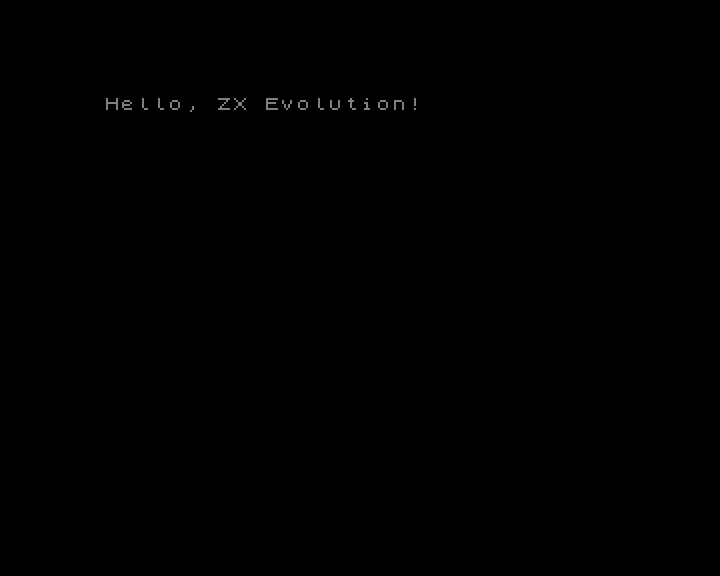
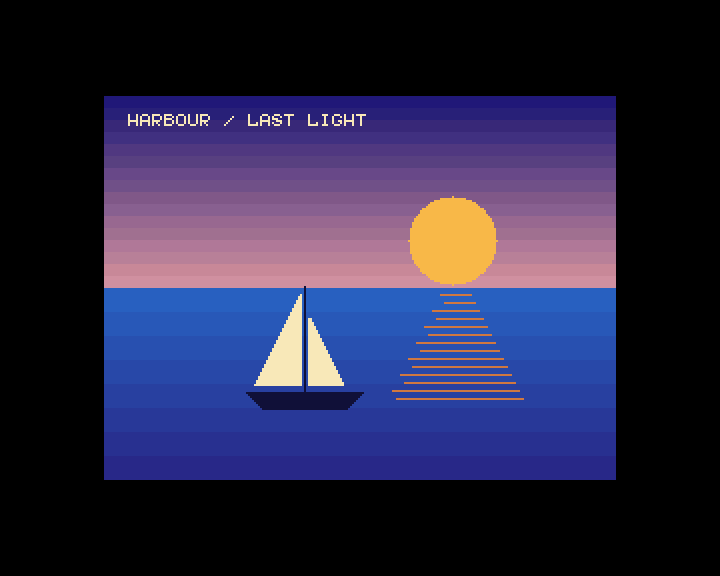
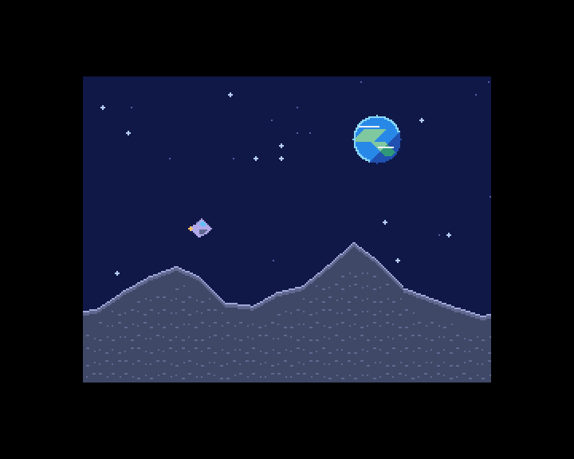

# Библиотека TSConf

[](README.en.md)
[](README.ru.md)

| Hello                                                       | Harbour                                                                     | Moon Run                                                                                         |
| ----------------------------------------------------------- | --------------------------------------------------------------------------- | ------------------------------------------------------------------------------------------------ |
|  |  |  |

`tsconf.lib` — архив Z80 для ABI classic SDCC в z88dk. Функции управления регистрами, видео и DMA
работают напрямую с TSConf. TS-FAT вызывает ROM TS-BIOS. Публичные функции доступны через
`<tsconf.h>`. [Заголовок](include/tsconf.h)

```sh
make tsconf-lib
make example-tsconf
make test-tsconf
```

## Сборка приложений

Подключите `lib/tsconf/tsconf.mk` из SDK. Для обычного CRT используйте `$(TSCONF_APP_FLAGS)`, для
TAP под BASIC 48 — `$(TSCONF_BASIC48_FLAGS) -create-app`. При прямом вызове zcc используйте
`tsconf.cfg`, сгенерированный рядом с архивом. Для каталога сборки по умолчанию это
`+<абсолютный-путь-к-zxevo-sdk>/lib/tsconf/build/default/tsconf.cfg`. `ZCCCFG` должен указывать на
стандартные конфигурации z88dk. Передайте путь к архиву через `-L`, а `lib/tsconf/include` и
`lib/common/include` добавьте в пути поиска заголовков. Сгенерированный конфиг включает пути к CRT и
поддерживает `-subtype=basic48`. [Настройки Make](tsconf.mk)

С другой целью zcc или своей точкой входа подключите архив через `-ltsconf` и используйте ABI
`-clib=classic -compiler=sdcc --reserve-regs-iy`. Линковщик выбирает аппаратную реализацию общих
символов `zx_`, например `zx_set_border_color()`, один раз на исполняемый файл, даже если приложение
подключает архивы обеих конфигураций.

<a id="selecting-video-backends"></a>

### Выбор видеорежимов при сборке

`TSCONF_VIDEO_MODES` выбирает режимы, для которых в архив входят консоль и рисование. Значение по
умолчанию — `ALL`. Также можно передать список из `ZX`, `16C`, `256C` и `TEXT` через пробел.

```sh
make -C lib/tsconf TSCONF_VIDEO_MODES=ZX
```

`TSCONF_BUILD` позволяет хранить сборки с разными настройками отдельно. Выбор поверхности и
`ts_video_set_mode` отклоняют исключённый режим рисования. Прямая запись видеорегистров остаётся
доступна.

При работе FPGA с опциональным растром 60 Гц собирайте архив с `TSCONF_VIDEO_60HZ=1`. Флаг задаёт
геометрию в библиотеке. Тайминг FPGA настраивается отдельно. В этом режиме у растра `360×288` 240
активных строк.

### Запуск из BASIC 48

`make examples-tsconf` собирает TAP для BASIC 48 в `lib/tsconf/build/examples/`.

- [`hello`](examples/hello.c) выбирает стандартный ZX-экран и выводит приветствие.
- [`harbour`](examples/harbour.c) рисует парусник на закате в режиме 256 цветов с палитрой RGB555,
  градиентом неба и отражением солнца.
- [`moon_run`](examples/moon_run.c) показывает полёт корабля над Луной. Корабль рисуют аппаратные
  спрайты, а два тайловых слоя движутся с разной скоростью и создают параллакс.

Расширенные сцены используют свободные страницы RAM выше `3Fh` и сохраняют палитру ZX в банке F.
[Профиль и загрузка TAP](../common/README.ru.md#профиль-запуска-из-basic-48)

## Аппаратные интерфейсы

- `zx_get_cpu_speed` и `zx_set_cpu_speed` используют настройки, записанные SDK, поскольку SysConfig
  и CacheConfig доступны только на запись. Первоначальные настройки задайте через
  `ts_set_cpu_speed_and_cache` или `ts_io_set_system_config`. Для отдельной настройки кэша по окнам
  используйте `ts_memory_set_cache`. `zx_set_cpu_speed` сохраняет эту маску. После записи в эти
  регистры мимо SDK задайте настройки через SDK заново. Обёртки TS-FAT учитывают изменение частоты в
  ROM. [Общий API тайминга](../common/include/zx/timing.h)
- `ts_io_read_status` читает Status, `ts_io_set_interrupt_mask` выбирает источники IRQ.
- `ts_irq_set_frame_position` настраивает позицию кадрового IRQ. `zx_frame_period` возвращает
  номинальный период для профиля сборки в тактах при 3,5 МГц. Для ожидания кадра при других IRQ
  увеличивайте резидентный байт в кадровом ISR и передайте его в `zx_wait_frame`.
  [Тайминг](include/tsconf/timing.h)
- `zx_uart_*` работает с UART Кондратьева через `F8EF–FFEF`. [UART](../common/include/zx/uart.h)
- `zx_rtc_*`, `zx_nvram_*`, `zx_eeprom_*` и `zx_ps2_*` используют индексные порты GlukClock.
  Включите его через `ts_rtc_set_enabled(1)`. Перед чтением версии AVR или журнала PS/2 выберите
  расширение через `zx_avr_window_select`. [Общий RTC](../common/include/zx/rtc.h) ·
  [Настройки RTC TSConf](include/tsconf/rtc.h) · [PS/2](../common/include/zx/ps2.h)
- `ts_joystick_read` читает Kempston при закрытых портах Beta Disk. `ts_fdd_set_config` настраивает
  FDDVirt. С выбранным физическим дисководом к регистрам Beta Disk обращаются через `zx_fdd_*`.
  [Ввод](include/tsconf/input.h) · [ВГ93](../common/include/zx/fdd.h)
- `ts_memory_set_page0` … `ts_memory_set_page3` отображают страницы в окна CPU.
  `ts_memory_set_config` выбирает ROM или RAM в W0, `ts_memory_set_cache` управляет кэшем окон. Для
  Page2 и Page3 есть чтение. `ts_map_ram_page` отображает RAM в W1–W3 и возвращает `zx_status_t`.
  `ts_window_acquire` и `ts_window_release` временно занимают W2 или W3. Держите дескриптор, код,
  стек и нужные данные вне занятого окна. Согласуйте доступ с TS-BIOS, рисованием в упакованных
  режимах и прямой записью страниц. [Память](include/tsconf/memory.h)
- `zx_ram_page_pool_init` и `zx_ram_page_alloc` управляют пулом физических страниц. Вызовите
  `ts_ram_heap_init` с выделенным `ts_window_lease_t`, чтобы привязать общую кучу к W2 или W3.
  Остальные операции выполняются через `zx_ram_heap_*`.
  [Общая память](../common/include/zx/memory.h)
- Общие заголовки также предоставляют PT3, Covox, мышь Kempston, управление IRQ Z80 и Nemo IDE PIO в
  сборках `IDE_HDD`. [Общие API](../common/README.ru.md)
- `ts_video_set_config`, `ts_video_set_page` и `ts_video_set_scroll` задают режим дисплея, базовую
  страницу и девятибитовые смещения. В заголовке есть функции для PalSel, Border, TSConfig и SGPage.
  Отобразите FMAPS через `ts_fmaps_enable` поверх RAM, которую можно перезаписать. Загрузите цвета
  CRAM и дескрипторы SFILE через `ts_fmaps_write_words`, затем вызовите `ts_fmaps_disable`.
  Согласуйте доступ с обработчиками IRQ и DMA. [Видео](include/tsconf/video.h)
- `ts_dma_start`, `ts_dma_busy` и `ts_dma_wait` управляют DMA напрямую. Перед запуском дождитесь
  свободного DMA. Для буферов используйте некэшируемые отображения CPU. В дескрипторе задаются
  физические страницы и чётные байтовые смещения. Число слов в пакете и число пакетов кодируются как
  значение минус один. `ts_dma_wait_polls` ограничивает число чтений статуса.
  `ts_dma_configure_wait_port` задаёт устройство и адрес AVR, `ts_dma_start_extended` программирует
  старшие биты числа пакетов в сборках FDR. [DMA](include/tsconf/dma.h)

## Текст и графика

Консоль и примитивы используют одну поверхность рисования. На TSConf `zx_init()` не требует
настройки. `zx_shutdown()` сбрасывает выбранную поверхность после освобождения окон и завершения
групп рисования. Настройки видимого экрана продолжают действовать. `ts_video_set_mode` настраивает
экран и рисование на той же поверхности. `ts_video_select_draw_screen` выбирает страницу с последней
геометрией экрана, `ts_video_select_draw_surface` задаёт свою геометрию. Прямые вызовы
`ts_video_set_config` и `ts_video_set_page` меняют экран и сохраняют поверхность рисования. В
стандартном ZX-режиме `zx_show_screen` показывает страницу 5 или 7 с границы строки. VConfig
доступен только на запись, поэтому перед `ts_video_select_draw_screen` или `zx_show_screen` задайте
его через библиотеку.

`zx_graphics_get_size` возвращает размеры поверхности, `ts_video_get_raster_size` — размеры растра
по последнему VConfig, записанному библиотекой. Текстовый режим удваивает ширину растра в пикселях.
`zx_console_get_size` возвращает число колонок и строк для выбранного шрифта и поверхности. При 60
Гц максимальная высота текстовой и упакованной консоли составляет 30 строк.

При включении stdio через `-pragma-define:CRT_ENABLE_STDIO=1` обычный `printf()` выводит на
выбранную поверхность в обоих профилях. Без stdio можно использовать `zx_console_puts()` для
вывода строки с текущей позиции курсора и `zx_console_printf()` для форматирования строк
и 16-битных чисел.
[Форматированный вывод](../common/include/zx/printf.h)

Перед выбором ZX-страницы или аппаратного текста отобразите её в CPU и сохраняйте отображение во
время вывода. Пример для свободного W3 и настроенной палитры ZX.

```c
ts_video_set_scroll(0, 0);
ts_memory_set_page3(0x60);
if (ts_video_set_mode(TS_VIDEO_ZX | TS_VIDEO_256X192 | TS_VIDEO_HIDE_TSU,
                      0x60, (volatile void *)0xc000) != ZX_OK) return 1;
zx_console_printf("TSConf %d\n", 48);
zx_draw_line(16, 16, 96, 64);
```

Строка аппаратного текста содержит 128 байт символов и 128 байт атрибутов. Отобразите страницу
шрифта `surface.page ^ 1` и загрузите стандартные ASCII-глифы через `ts_console_load_text_font`.
Затем отобразите и выберите страницу текста. В ZX, 16c и 256c передайте `&zx_font8`, `&zx_font5` или
собственный дескриптор в `zx_console_set_font`. `zx_set_ink` и `zx_set_paper` задают цвета консоли.
Они сохраняются при смене поверхности. Координаты консоли отсчитываются от начала поверхности.

`zx_console_clear` очищает поверхность и возвращает курсор в начало. В 16c и 256c заполняется вся
поверхность 512×512 цветом бумаги. `zx_draw_fill_rect` и `zx_draw_clear_rect` работают с
прямоугольной областью. В ZX они устанавливают или сбрасывают биты, сохраняя атрибуты.
`zx_read_pixel_index` читает индекс в тех же координатах. В ZX он учитывает BRIGHT и возвращает ink
или paper независимо от фазы FLASH. В упакованных режимах рисование временно занимает W3 и
восстанавливает его. Код, данные, стек и обработчики должны находиться вне W3.

Общие примитивы `zx_draw_*` поддерживают SET, CLEAR и XOR. В упакованных режимах они используют
текущие цвета чернил и бумаги. `zx_graphics_begin` и `zx_graphics_end` удерживают W3 для группы
операций. `zx_console_draw` печатает по координатам ячейки без перемещения курсора.
`ts_console_set_autoscroll(1)` включает прокрутку на строку. В упакованных режимах для прокрутки
нужно до 360 дополнительных байт стека. [Общая консоль](../common/include/zx/console.h) ·
[Аппаратный текст](include/tsconf/console.h) · [Общая графика](../common/include/zx/graphics.h)

## Тайлы

Две карты 64×64 используют общую физическую страницу, выбранную через `ts_video_set_tile_map_page`.
У каждого слоя свой упакованный атлас 512×512 в 4bpp и девятибитовые смещения по X и Y. Начало
атласа выравнивается по восьми страницам. Загрузите атлас и палитру, затем заполните карту при
скрытом слое. В примере тайл 65 помещается в колонку 3, строку 2 слоя 0. W3 свободно для карты.

```c
ts_video_set_tile_map_page(0x60);
ts_video_set_tile0_page(0x48);
ts_memory_set_page3(0x60);
ts_video_write_tile((volatile void *)0xc000, 0, 3, 2, TS_TILE_ENTRY(65, 2) | TS_TILE_FLIP_X);
ts_video_set_tile0_scroll(0, 0);
ts_video_set_tsu_config(TS_TSU_TILE0);
```

Запись выбирает локальную палитру 2 внутри группы PalSel слоя T0. Пиксель с индексом 0 прозрачен.
Тайл с индексом 0 отображается, если установлен соответствующий `TS_TSU_TILE0_INDEX0` или
`TS_TSU_TILE1_INDEX0`.

## SD SPI и TS-FAT

Прямой API SD1 инициализирует карту, читает CID, CSD и OCR и работает с физическими секторами без
TS-BIOS. `zx_sd_begin` и `zx_sd_end` ограничивают ручной обмен командами и данными. Сериализуйте
доступ к SPI. [Общий SD](../common/include/zx/sd.h)

Для TS-FAT отключите прерывания перед отображением логической страницы ROM 0 в W0. Вызовите
`ts_memory_set_page0(0)` и `ts_memory_set_config(TS_MEM_W0_DIRECT)`. VDOS и DivMMC должны быть
неактивны, чтобы `RST 10h` попал в TS-BIOS. Зарезервируйте RAM-страницу `F7h`. ROM отображает её в
W2 (`8000h–BFFFh`) для рабочих данных и своего стека. Код, стек возврата и запись имени файла должны
быть вне W2. ROM восстанавливает Page2 и SP, записывает `02h` в SysConfig (14 МГц, кэш отключён) и
оставляет маскируемые прерывания отключёнными.

При свободном DMA и эксклюзивном доступе к потоку ROM и SD вызовите `ts_fat_mount_sd()`, затем
`ts_fat_open()` с нулевым типом и именем 8.3 в верхнем регистре для файла в корне FAT32. Обе функции
возвращают `ZX_OK` при успехе или `ZX_IO_ERROR`, если ROM сообщил об ошибке. `ts_fat_open`
записывает длину файла. `ts_fat_read_sector()` читает сектор в физическую страницу RAM по чётному
смещению и продвигает позицию после успешного чтения. По длине файла определите конец и число
действительных байтов последнего сектора. ROM может ждать SD без ограничения и затирает статус
READ512 при возврате.

API также монтирует Nemo IDE, открывает каталоги, возвращается в корень, сбрасывает позицию,
пропускает сектора, создаёт, записывает и удаляет файлы. Для монтирования IDE включите источник
кадрового IRQ. Для IDE slave нужен TS-BIOS с исправленным LBA-селектором диска. Статус WRITE512 при
возврате имеет то же ограничение, что READ512. [TS-FAT](include/tsconf/fat.h)

## Расширения

- `ts_spi_*` предоставляет выбор устройства SPI и побайтовый обмен.
- `ts_zifi_*` работает с FIFO legacy ZiFi и расширенного RS-232 через AVR, включая события RX.
- `ts_copper_*` загружает и запускает списки в сборках COPPER, `ts_fdr_*` управляет захватом и
  читает счётчик в сборках FDR.
- `ts_ft812_*` предоставляет команды EVE, обмен с памятью, настройку растра, смену display list и
  переключение внешнего видео VDAC2.
- `ts_zifi32_*` предоставляет регистры ESP32 по SPI, команды прошивки и выровненный блочный обмен.
  Доступ к общей SPI-шине между устройствами и SD сериализует приложение.

[SPI](include/tsconf/spi.h) · [ZiFi](include/tsconf/zifi.h) · [Copper](include/tsconf/copper.h) ·
[FDR](include/tsconf/fdr.h) · [FT812](include/tsconf/ft812.h) · [ZiFi32](include/tsconf/zifi32.h)

<a id="emulator-tests"></a>

## Тесты в эмуляторе

Набор работает через общий раннер и ZXHost на машине **TSConf** в ZEsarUX. W1 остаётся резидентным
для почтового ящика и данных C. Большинство кейсов выполняются из W2 и используют W3 для страниц
фикстур. Эмулятор задаётся через `make test-tsconf ZESARUX=/path/to/zesarux`. Для одного кейса
используйте `python3 lib/tsconf/tests/run.py check --case video/video`, для всего каталога
`--case video`. [Раннер](../test_support/README.ru.md) · [Общие тесты](../common/tests/README.ru.md)

Кейсы проверяют регистры, отображение RAM, растровые IRQ, DMA, SD SPI, legacy ZiFi, графику,
прокрутку и регистры Beta Disk. Снимки проверяют итоговое изображение. ZEsarUX пишет байты FMAPS
отдельно, а FPGA фиксирует слово при записи нечётного байта. В 256c эмулятор считывает лишний
пиксель на горизонтальном переходе, поэтому эталон прокрутки проверяет бит 8 координаты X и
вертикальный переход. Аналоговое видео, точный тайминг, арбитраж и возможности отдельных сборок FPGA
требуют проверки на плате.

Кейсы TS-FAT выполняются из W3 со стеком в W3 и ROM TS-BIOS в W0. SD-кейс проверяет чтение и
навигацию. Nemo IDE проверяет создание, запись и удаление. ZEsarUX реализует запись IDE DMA, поэтому
этот кейс использует IDE. Copper и FDR проверяются на уровне памяти и регистров. Кейсы AVR, FT812 и
ZiFi32 используют фикстуры для транзакций и ответов.
`python3 lib/tsconf/tests/run.py check --case fat/ts_fat` использует ROM эмулятора. Через
`ZXEVO_TEST_ROM` можно указать другой TS-BIOS.
