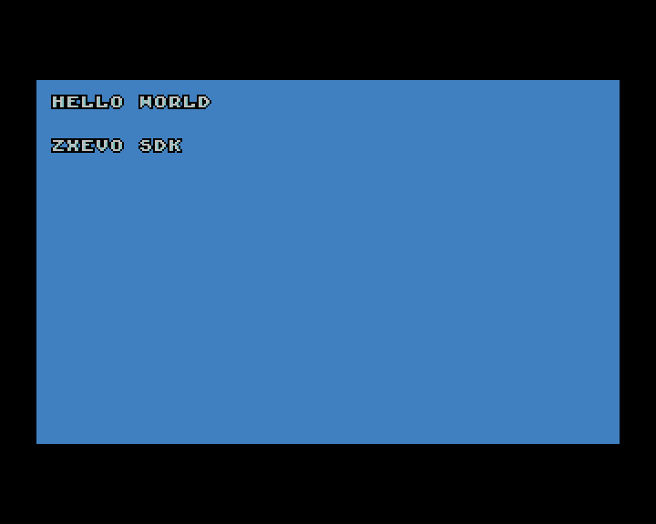
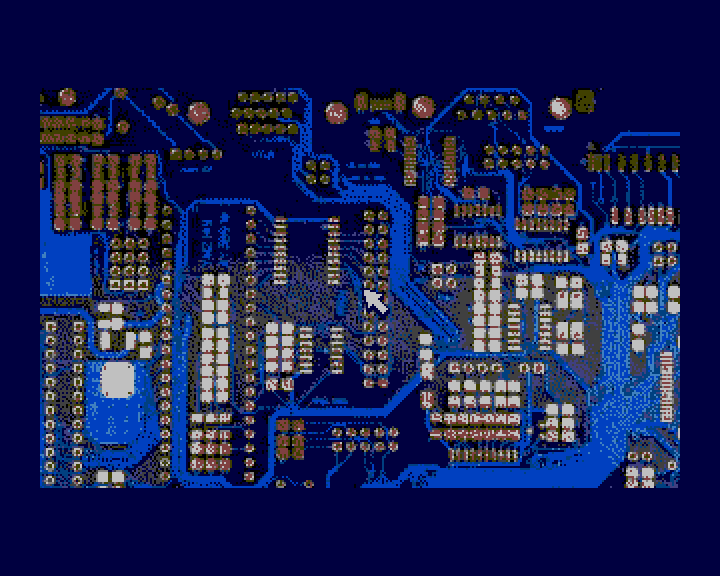
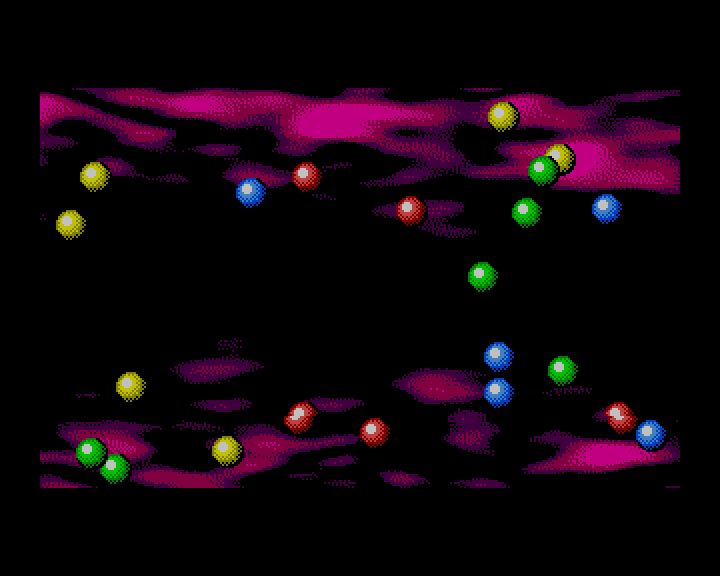
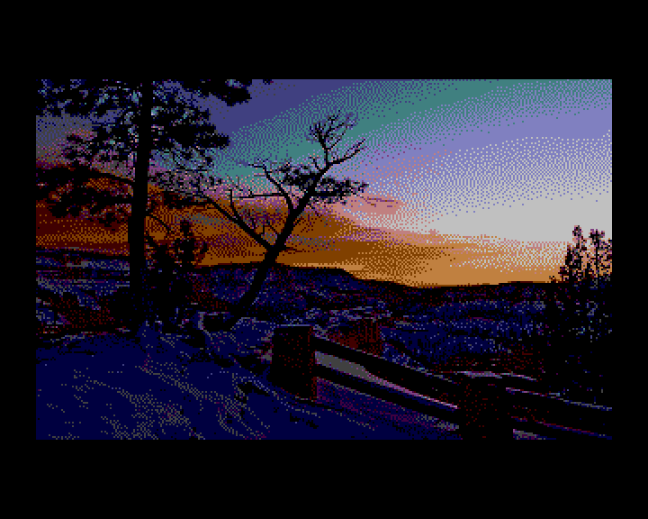

# evosdk examples for TSConf

[](README.en.md)
[](README.ru.md)

Ports of four Shiru / Alone Coder demonstrations from `pentevo/sdk/evosdkts` in the
[TSConf repository](https://github.com/tslabs/zx-evo), using the original BMP assets and the current
zxevo-sdk. Keyboard, joystick, mouse, RNG and ordinary memory operations use z88dk. The balls and
pointer use **TSConf hardware sprites**.

| Font / Keyboard                                                 | Mouse / Joystick                                                                       |
| --------------------------------------------------------------- | -------------------------------------------------------------------------------------- |
|  |  |

| Sprites                                           | Slideshow                                              |
| ------------------------------------------------- | ------------------------------------------------------ |
|  |  |

| Example                 | Demonstrates                                                              | Controls                                            |
| ----------------------- | ------------------------------------------------------------------------- | --------------------------------------------------- |
| `empty`                 | Minimal BASIC 48 project                                                  | Returns to BASIC immediately                        |
| `font_keyboard`         | Original color 8×8 font, line breaks, key press events                    | A–Z, 0–9, Space, Enter                              |
| `mouse_joystick`        | Original background and 16×16 pointer, button-dependent border color      | Kempston mouse, Kempston joystick or Cursor 5/6/7/8 |
| `sprites`               | 22 balls of 16×16 pixels, four original images                            | Automatic animation                                 |
| `slideshow`             | Five original pictures, transitions through black/white                   | Left/right with transitions, up/down without        |
| [XNX](xnx/README.en.md) | Full ten-level game, hardware sprites, PT3/AYFX/Covox; separate SPG build | Kempston/Cursor, Space, P to pause                  |

CAPS SHIFT + SPACE returns to BASIC in the four TAP demonstrations. XNX starts separately through
SPG and uses its own IM2 setup. Load TAPs with `LOAD ""` in **BASIC 48 on TSConf**. The pages listed
below must be available, DOS/FDDVirt and CPU caches disabled, and the BASIC frame interrupt must be
the only INT source. The examples own DMA, FMAPS and video registers while running. On exit they
disable TSU, restore W3 and the standard BASIC ZX screen and border. They do not preserve arbitrary
state from a previous graphics application.

## Building

From the SDK root, with z88dk on PATH and ZCCCFG configured:

```sh
make examples-evosdk
```

Python 3.11+ is required. The asset recipe prepares its Python dependencies automatically on first
use; no venv activation or `PYTHON=...` override is needed. The first preparation needs access to
the packages; subsequent builds reuse the environment.

Resources use ZX0 by default. Output: `lib/tsconf/examples/evosdk/build/zx0/<example>/demo.tap`. For
uncompressed resources:

```sh
make examples-evosdk COMPRESSION=none
```

Both builds use the same application code; compression only selects the resource loading path.
`COMPRESSION` is read by this directory's Makefile and passed to `assets.py`; it applies to these
TAP demonstrations only. XNX is built separately as SPG and uses appmake's `--spg-compression=auto`
option. The Makefile explicitly links `-lzx_clib`: the standard TSConf target uses generic Z80 libc,
while the Spectrum implementations of `input.h`/`games.h` live in `zx_clib`. Include z88dk's
`<compress/zx0.h>` for the decoder.

## Loading images

1. The shared [converter](../../../../tools/assets/README.en.md) reads BMP files, preserves palette
   indices and converts pixels to linear 4bpp, with the left pixel in the high nibble. Palettes use
   RGB222.
2. `assets.py` defines resource selection and placement. Images are split on whole rows into blocks
   of at most 2048 unpacked bytes. A background block holds 12 rows of 160 bytes, or 1920 bytes.
3. `z88dk-zx0` compresses **each binary block independently**. The shared emitter places the bytes
   into ASM sections `BANK_80`, `BANK_81`, and so on. A C header records each resource's page,
   offset, row count and palette.
4. SDK appmake combines resident code and BANK sections into one TAP. Its BASIC loader places banked
   blocks into physical RAM through W3, restores that window and calls the CRT.
5. The example maps the compressed resource page into W3. z88dk's `dzx0_standard()` expands it into
   a resident W2 buffer, then DMA transfers rows to video RAM with stride 256. The buffer is
   even-aligned because DMA ignores address bit zero; one extra byte is reserved for alignment. The
   buffer is not reused until DMA completes. In the `none` build, DMA reads the resource directly.
6. Ball/pointer pixels go into the TSU atlas; only SFILE descriptors change each frame. The
   slideshow loads the next hidden screen, then changes VPage.

Source sprites use indices ≥16 for transparency. Conversion maps those pixels to hardware index zero
and renumbers opaque colors to 1…15. Separate palette bank 1 preserves opaque black without changing
background indices. Backgrounds use bank 0; BASIC's bank 15 is left intact. Brightness uses RGB222
values and TSConf levels 0/8/16/24.

| CPU / physical region      | Purpose                                                                    |
| -------------------------- | -------------------------------------------------------------------------- |
| W0, `0000–3FFF`            | BASIC 48 ROM                                                               |
| W1, `4000–7FFF`            | BASIC screen, system variables and stack                                   |
| W2, `8000–AFFF`            | CRT, code, constants, DATA                                                 |
| W2, `B000–BFFF`            | BSS, including 2048 decode bytes and one alignment byte; excluded from TAP |
| W3, `C000–FFFF`            | Temporary resource window or scratch page `C0h`                            |
| Pages `40h–43h`, `48h–4Bh` | Two 320×200 screens with stride 256; VPage aligned to eight pages          |
| Pages `80h…`               | Banked resources; the generator rejects overlap with `B0h`                 |
| Page `B0h`                 | Used portion of the font/sprite atlas, base aligned to eight pages         |
| Page `C0h`                 | Disposable FMAPS backing memory and zero SFILE descriptors                 |

## Input and video APIs

- `in_KeyPressed()` with a previous-state table detects new key presses.
- `joystick(1)` and `joystick(4)` read Kempston and Cursor; Space adds Fire.
- `in_MouseKemp()` returns coordinates within 256×192 and two buttons. The example recenters the
  mouse each frame to accumulate relative movement; `inp()` reads the middle button.
- `ts_video_set_mode`, `ts_dma_start` and TSU sprite descriptors display the images and moving
  objects. The slideshow draws to the hidden screen before switching VPage.

## Provenance

Game code and assets originate from `pentevo/sdk/evosdkts` in the TSConf repository. The original
package license is preserved in [assets/upstream-license.txt](assets/upstream-license.txt).
