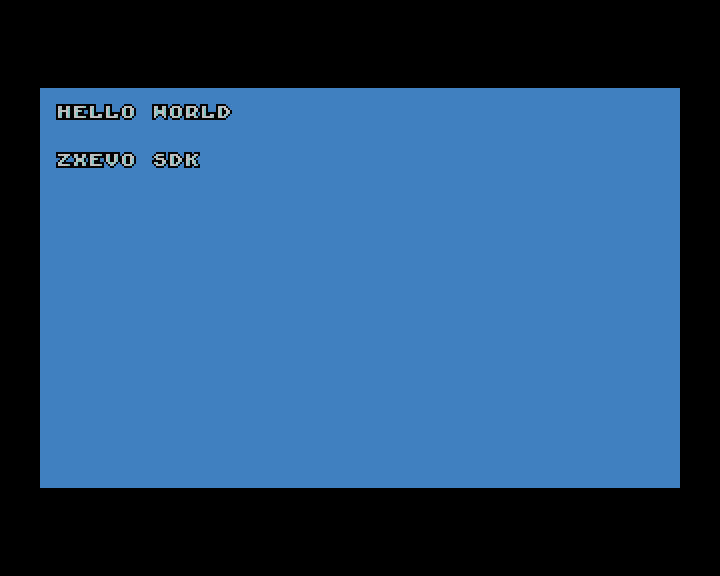
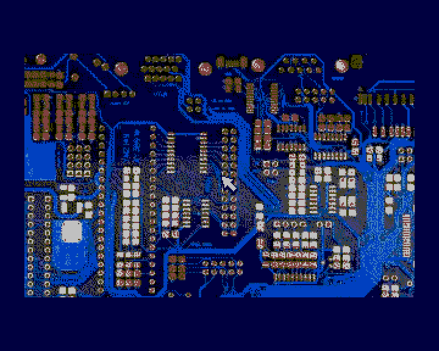
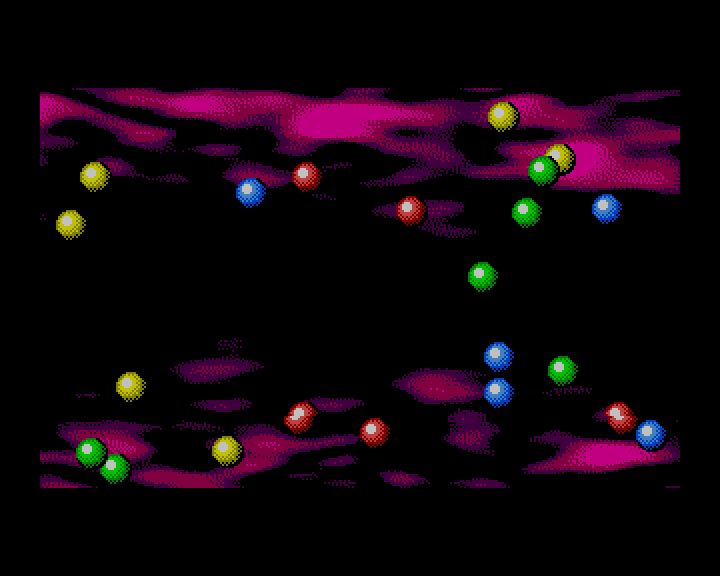
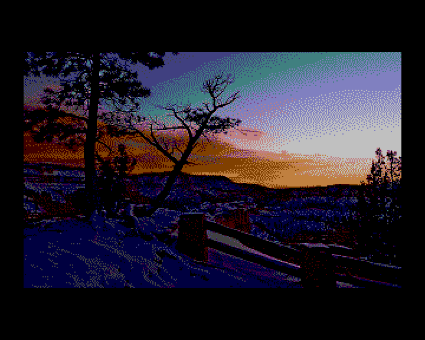

# Примеры evosdk для TSConf

[](README.en.md)
[](README.ru.md)

Порты четырёх демонстраций Shiru / Alone Coder из каталога `pentevo/sdk/evosdkts`
[репозитория TSConf](https://github.com/tslabs/zx-evo) используют исходные BMP и текущий zxevo-sdk.
Клавиатура, джойстик, мышь, RNG и обычные операции с памятью взяты из z88dk. Шарики и указатель
выводятся **аппаратными спрайтами TSConf**.

| Font / Keyboard                                                     | Mouse / Joystick                                                              |
| ------------------------------------------------------------------- | ----------------------------------------------------------------------------- |
|  |  |

| Sprites                                                | Slideshow                                                 |
| ------------------------------------------------------ | --------------------------------------------------------- |
|  |  |

| Пример                  | Что показывает                                                                        | Управление                                            |
| ----------------------- | ------------------------------------------------------------------------------------- | ----------------------------------------------------- |
| `empty`                 | Минимальный проект BASIC 48                                                           | Сразу возвращается в BASIC                            |
| `font_keyboard`         | Исходный цветной шрифт 8×8, перенос строк, события нажатия                            | A–Z, 0–9, Space, Enter                                |
| `mouse_joystick`        | Исходный фон и указатель 16×16, цвет бордюра по кнопке                                | Kempston mouse, Kempston joystick или Cursor 5/6/7/8  |
| `sprites`               | 22 шарика 16×16, четыре исходных изображения                                          | Автоматическая анимация                               |
| `slideshow`             | Пять исходных картинок, переходы через чёрный/белый                                   | Влево/вправо — с переходом, вверх/вниз — без перехода |
| [XNX](xnx/README.ru.md) | Полная игра, десять уровней, аппаратные спрайты, PT3/AYFX/Covox; отдельная SPG-сборка | Kempston/Cursor, Space, P — пауза                     |

В четырёх TAP-демонстрациях CAPS SHIFT + SPACE возвращает в BASIC. XNX запускается отдельно через
SPG и использует собственный IM2. Запускайте TAP через `LOAD ""` в **BASIC 48 на TSConf**. Должны
быть доступны страницы из карты ниже, выключены DOS/FDDVirt и кэш CPU; единственный источник INT —
кадровое прерывание BASIC. Примеры владеют DMA, FMAPS и видеорегистрами во время работы. При выходе
выключают TSU, восстанавливают W3 и стандартный ZX-экран BASIC с его бордюром. Произвольное
состояние предыдущего графического приложения не сохраняется.

## Сборка

Из корня SDK, с z88dk на PATH и настроенным ZCCCFG:

```sh
make examples-evosdk
```

Нужен Python 3.11+. Сборщик ресурсов сам готовит зависимости при первом запуске; активировать venv
или передавать `PYTHON=...` не требуется. Для первой подготовки нужен доступ к пакетам; последующие
сборки переиспользуют окружение.

По умолчанию ресурсы сжимаются ZX0. Результат:
`lib/tsconf/examples/evosdk/build/zx0/<пример>/demo.tap`. Для несжатых ресурсов:

```sh
make examples-evosdk COMPRESSION=none
```

Оба варианта используют один код приложения; упаковка выбирает только путь загрузки ресурсов.
`COMPRESSION` читает Makefile этого каталога и передаёт в `assets.py`; параметр действует только для
этих TAP-демонстраций. XNX собирается отдельно в SPG и использует параметр appmake
`--spg-compression=auto`. `-lzx_clib` подключён в Makefile явно: стандартный TSConf target
использует generic Z80 libc, а Spectrum-реализации `input.h`/`games.h` живут в `zx_clib`. Для
распаковщика подключите `<compress/zx0.h>` из z88dk.

## Как загружаются картинки

1. Общий [конвертер](../../../../tools/assets/README.ru.md) читает BMP, сохраняет индексы и
   преобразует их в линейный 4bpp: старший полубайт — левый пиксель. Палитра — RGB222.
2. `assets.py` задаёт только набор ресурсов и размещение. Изображение делится по целым строкам на
   блоки не больше 2048 распакованных байт. Для фона это 12 строк по 160 байт, всего 1920.
3. `z88dk-zx0` сжимает **каждый бинарный блок отдельно**. Затем общий генератор исходников помещает
   байты в ASM-секции `BANK_80`, `BANK_81` и далее. C-заголовок хранит страницу, смещение, число
   строк и палитру каждого ресурса.
4. SDK appmake объединяет резидентный код и BANK-секции в один TAP. BASIC-загрузчик помещает
   банковые блоки в физическую RAM через W3, затем восстанавливает его отображение и вызывает CRT.
5. Пример отображает страницу с упакованным блоком в W3. `dzx0_standard()` из z88dk распаковывает
   его в резидентный буфер W2. После завершения DMA переносит строки в видеопамять со stride 256.
   Буфер выровнен на чётный адрес: DMA игнорирует младший бит адреса. Для выравнивания
   зарезервирован один дополнительный байт. Буфер не переиспользуется до окончания DMA. В варианте
   `none` DMA читает ресурс напрямую.
6. Для шариков/указателя пиксели попадают в атлас TSU; на каждом кадре меняются только дескрипторы
   SFILE. Для слайд-шоу загружается следующий скрытый экран, затем меняется VPage.

Спрайты в исходных BMP обозначают прозрачность индексами ≥16. Конвертер переводит их в аппаратный
индекс 0, а непрозрачные цвета перенумеровывает в 1…15. Отдельный банк палитры 1 позволяет сохранить
непрозрачный чёрный, не меняя индексы фона. Фон использует банк 0; банк 15 BASIC не
перезаписывается. Яркость использует значения RGB222 и уровни TSConf 0/8/16/24.

| CPU/физическая область        | Назначение                                                                       |
| ----------------------------- | -------------------------------------------------------------------------------- |
| W0, `0000–3FFF`               | ROM BASIC 48                                                                     |
| W1, `4000–7FFF`               | Экран/системные переменные BASIC и его стек                                      |
| W2, `8000–AFFF`               | CRT, код, константы, DATA                                                        |
| W2, `B000–BFFF`               | BSS, включая 2048 байт распаковки и байт для выравнивания; не записывается в TAP |
| W3, `C000–FFFF`               | Временное окно ресурса либо рабочей страницы `C0h`                               |
| Страницы `40h–43h`, `48h–4Bh` | Два экрана 320×200 со stride 256; VPage выровнен на 8 страниц                    |
| Страницы `80h…`               | Банковые ресурсы, генератор запрещает пересечение с `B0h`                        |
| Страница `B0h`                | Используемая часть атласа шрифта или спрайтов, база выровнена на 8 страниц       |
| Страница `C0h`                | Одноразовая подложка FMAPS и нулевые дескрипторы SFILE                           |

## API ввода и видео

- `in_KeyPressed()` с таблицей предыдущих состояний определяет новые нажатия.
- `joystick(1)` и `joystick(4)` читают Kempston и Cursor; Space добавляет Fire.
- `in_MouseKemp()` возвращает координаты в пределах 256×192 и две кнопки. Пример центрирует мышь на
  каждом кадре для накопления относительного перемещения; средняя кнопка читается через `inp()`.
- `ts_video_set_mode`, `ts_dma_start` и дескрипторы спрайтов TSU выводят изображения и движущиеся
  объекты. Слайд-шоу рисует на скрытом экране до смены VPage.

## Происхождение

Игровой код и ресурсы взяты из `pentevo/sdk/evosdkts` репозитория TSConf. Лицензия исходного пакета
сохранена в [assets/upstream-license.txt](assets/upstream-license.txt).
