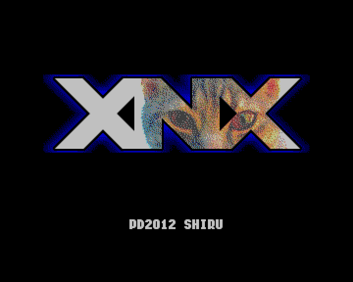
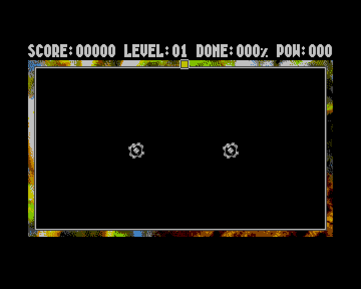

# XNX for zxevo-sdk / TSConf

[](README.en.md)
[](README.ru.md)

Port of Shiru / Alone Coder's XNX from `pentevo/sdk/evosdkts/game_xnx` in the
[TSConf repository](https://github.com/tslabs/zx-evo). It retains all ten levels, the title
animation, movement and area-capture rules, scoring, pause, transitions, game-over and completion
scenes, original graphics, five PT3 tracks, three AYFX effects and two WAV samples.

| Title                                      | Level 1                              |
| ------------------------------------------ | ------------------------------------ |
|  |  |

## Build and run

From the SDK root, with z88dk on PATH and Python 3.11+ available:

```sh
make examples-xnx
```

Running `make` directly in this directory also works. The
[asset tools](../../../../../tools/assets/README.en.md) prepare and reuse their Python dependencies
automatically. No venv activation or `PYTHON=...` override is needed; first-time setup requires
access to the packages.

The result is `lib/tsconf/examples/evosdk/xnx/build/xnx.spg`. Run it with a TSConf loader supporting
SpectrumProg 1.0, or open it in ZEsarUX. The application uses the standalone CRT and does not return
to BASIC. No TAP version is generated.

Controls: Kempston joystick or Cursor 5/6/7/8; Space to start/continue, P to pause. Move inward from
the field boundary to start a line, which keeps moving after key release. Close it to reveal an
area, avoiding enemies and your own trail. Reach the target percentage to finish each level. Space
after Game Over returns to the title. Reset the machine to exit.

## Implementation

`main.c` contains the game rules; `platform.c` connects them to zxevo-sdk video, memory, input and
audio APIs. The Makefile selects the TSConf standalone CRT, `+tsconf --format=spg`, a stack at
`BDB0h` and an SPG loader resident at `BC80h`.

Opaque 8×8 tiles use `ts_video_draw_16c_tile` and DMA. For a transparent tile, `ts_window_acquire`
maps its bank into W3, the tile is copied to a resident buffer, and `zx_blit4_key` draws it with
palette index 1 as the transparency key. `ts_video_fill_16c_screen` and `ts_video_copy_16c_*` keep
the two framebuffers in sync. Moving objects and transition masks use TSConf hardware sprites
through `ts_video_upload_sprites` and `ts_video_set_sprite_page`.

The `assets.py` recipe uses [tools/assets](../../../../../tools/assets/README.en.md) to convert BMP
images into 4bpp tiles, assemble the sprite atlas and convert WAV into unsigned PCM8. Generated ASM
sections place resources directly in physical RAM pages. SDK appmake compresses occupied SPG pages
with MegaLZ or Hrust; the SPG loader restores them before entry. Joystick and keyboard input use
z88dk `games.h` and `input.h`.

### Audio

z88dk `im2.h` supplies the frame ISR and C hook; `im2_Init_fastcall` matches the classic fastcall
ABI. The hook calls `zx_pt3_play()` and `zx_ayfx_frame()`. `zx_ay_select_chip` selects the
TurboSound chip for each player.

`zx_pcm8_play_banked` plays samples described by `zx_pcm8_banked_t` through W3. The caller selects
3.5 MHz before playback and restores 14 MHz afterwards. The function restores the previous W3 page
and interrupt state. Resident samples can use `zx_covox_play`.

## Memory map

| Area                           | Use                                                                                               |
| ------------------------------ | ------------------------------------------------------------------------------------------------- |
| W0 `0000–3FFF`                 | BASIC ROM; its IM1 handler is not used                                                            |
| W1/W2 `4000–BFFF`, RAM 5/2     | Program RAM: code, constants, DATA/BSS, ISR and stack; CRT clears BSS, which is excluded from SPG |
| `BC80–BC8F`                    | SPG loader resident; appmake rejects overlap with code/BSS                                        |
| Below `BDB0`, growing downward | Stack; keep it above the ISR at B9B9–B9C9                                                         |
| `B9B9–B9C9`, `BE00–BF00`       | z88dk generic ISR/hooks and vector table                                                          |
| W3 `C000–FFFF`                 | Temporary resource, tile, framebuffer or scratch mapping                                          |
| RAM `20h–39h`                  | Tile images loaded by SPG                                                                         |
| RAM `60h–63h`, `68h–6Bh`       | Two 320×200 framebuffers with 256-byte stride                                                     |
| RAM `70h`                      | Atlas of 43 hardware sprite images                                                                |
| RAM `C0h–C2h`                  | PCM8 samples loaded by SPG                                                                        |
| RAM `D0h`                      | FMAPS/SFILE scratch                                                                               |

The program owns these RAM pages, video registers, DMA, AY/Covox and frame interrupts. Music timing
assumes 50 Hz frames. Startup explicitly selects 14 MHz and disables caching, independently of
whether a particular SPG loader applies the header's clock setting.

The original evosdk license for the game code and assets is retained
[here](../assets/upstream-license.txt).
