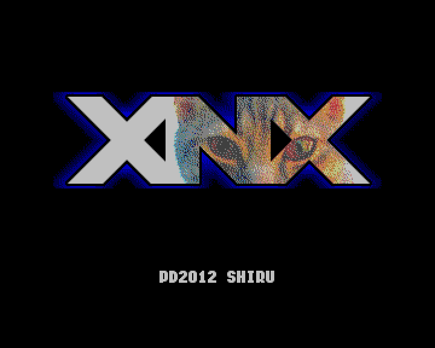
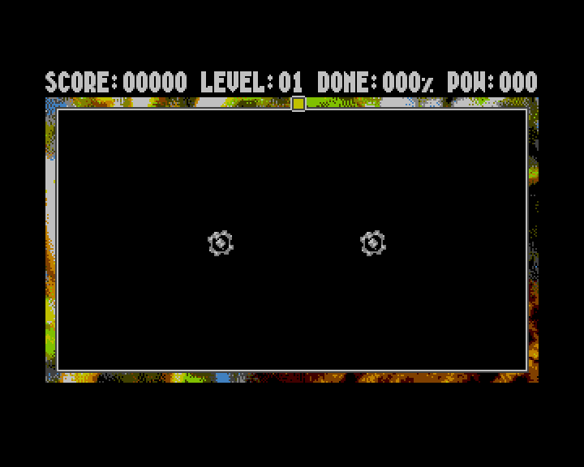

# XNX для zxevo-sdk / TSConf

[](README.en.md)
[](README.ru.md)

Порт игры XNX Shiru / Alone Coder из `pentevo/sdk/evosdkts/game_xnx`
[репозитория TSConf](https://github.com/tslabs/zx-evo). Сохранены десять уровней, титульная сцена,
правила движения и захвата областей, очки, пауза, переходы, поражение и завершение игры, исходная
графика, пять PT3-треков, три AYFX-эффекта и два WAV-сэмпла.

| Титульный экран                               | Уровень 1                                 |
| --------------------------------------------- | ----------------------------------------- |
|  |  |

## Сборка и запуск

Из корня SDK с z88dk на PATH и установленным Python 3.11+:

```sh
make examples-xnx
```

Можно также вызвать обычный `make` прямо в этом каталоге.
[Инструменты ресурсов](../../../../../tools/assets/README.ru.md) автоматически готовят и
переиспользуют зависимости Python. Активация venv и `PYTHON=...` не нужны; при первой подготовке
требуется доступ к пакетам.

Результат — `lib/tsconf/examples/evosdk/xnx/build/xnx.spg`. Запускайте SPG через загрузчик TSConf,
поддерживающий формат SpectrumProg 1.0, либо открывайте в ZEsarUX. Программа использует standalone
CRT и не возвращается в BASIC. TAP-версия не создаётся.

Управление: Kempston joystick или Cursor 5/6/7/8; Space — начать/продолжить, P — пауза. С границы
поля начните движение внутрь: линия продолжает движение после отпускания клавиши. Замкнув линию,
открывайте область изображения, избегая противников и пересечения своей линии. Для завершения уровня
нужен указанный процент раскрытия. После Game Over Space возвращает к титулу; для выхода из
standalone-программы используется сброс машины.

## Реализация

`main.c` содержит правила игры; `platform.c` связывает их с API видео, памяти, ввода и звука
zxevo-sdk. Makefile выбирает автономный CRT TSConf, `+tsconf --format=spg`, стек в `BDB0h` и
резидент загрузчика SPG в `BC80h`.

Непрозрачные тайлы 8×8 выводятся через `ts_video_draw_16c_tile` и DMA. Для прозрачного тайла
`ts_window_acquire` отображает его банк в W3, тайл копируется в резидентный буфер, затем
`zx_blit4_key` рисует его с индексом 1 в качестве ключа прозрачности. `ts_video_fill_16c_screen` и
`ts_video_copy_16c_*` синхронизируют два экранных буфера. Движущиеся объекты и переходные маски
используют аппаратные спрайты TSConf через `ts_video_upload_sprites` и `ts_video_set_sprite_page`.

Рецепт `assets.py` через [tools/assets](../../../../../tools/assets/README.ru.md) преобразует BMP в
тайлы 4bpp, собирает атлас спрайтов, а WAV преобразует в unsigned PCM8. Созданные ASM-секции
помещают ресурсы непосредственно в физические страницы RAM. SDK appmake сжимает занятые страницы SPG
в MegaLZ или Hrust; загрузчик SPG восстанавливает их до запуска программы. Ввод с джойстика и
клавиатуры использует `games.h` и `input.h` z88dk.

### Звук

`im2.h` z88dk создаёт кадровый ISR с C hook; `im2_Init_fastcall` соответствует classic fastcall ABI.
Hook вызывает `zx_pt3_play()` и `zx_ayfx_frame()`. `zx_ay_select_chip` выбирает чип TurboSound для
каждого плеера.

`zx_pcm8_play_banked` воспроизводит сэмплы из W3 по дескриптору `zx_pcm8_banked_t`. Вызывающий код
устанавливает 3,5 МГц перед воспроизведением и возвращает 14 МГц после него. Функция восстанавливает
прежнюю страницу W3 и состояние прерываний. Для резидентных сэмплов доступна `zx_covox_play`.

## Карта памяти

| Область                    | Использование                                                                            |
| -------------------------- | ---------------------------------------------------------------------------------------- |
| W0 `0000–3FFF`             | BASIC ROM; её обработчик IM1 не используется                                             |
| W1/W2 `4000–BFFF`, RAM 5/2 | RAM программы: код, константы, DATA/BSS, ISR и стек; BSS очищает CRT и в SPG не хранится |
| `BC80–BC8F`                | Резидент SPG-загрузчика; упаковщик отклоняет пересечение с кодом/BSS                     |
| До `BDB0` сверху вниз      | Стек; не должен достигать ISR B9B9–B9C9                                                  |
| `B9B9–B9C9`, `BE00–BF00`   | Generic ISR/hooks z88dk и таблица векторов                                               |
| W3 `C000–FFFF`             | Временное отображение ресурса, тайла, framebuffer или scratch                            |
| RAM `20h–39h`              | Тайловые изображения, загруженные из SPG                                                 |
| RAM `60h–63h`, `68h–6Bh`   | Два framebuffer 320×200, stride 256 байт                                                 |
| RAM `70h`                  | Атлас 43 аппаратных спрайтов                                                             |
| RAM `C0h–C2h`              | PCM8-сэмплы, загруженные из SPG                                                          |
| RAM `D0h`                  | Scratch для FMAPS/SFILE                                                                  |

Программа владеет указанной RAM, видеорегистрами, DMA, AY/Covox и кадровым INT. Для музыкального
темпа предполагается кадровая частота 50 Гц. При запуске явно выбираются 14 МГц и отключённый кэш,
независимо от применения clock-поля SPG конкретным загрузчиком.

Исходная лицензия evosdk для игрового кода и ресурсов сохранена
[здесь](../assets/upstream-license.txt).
